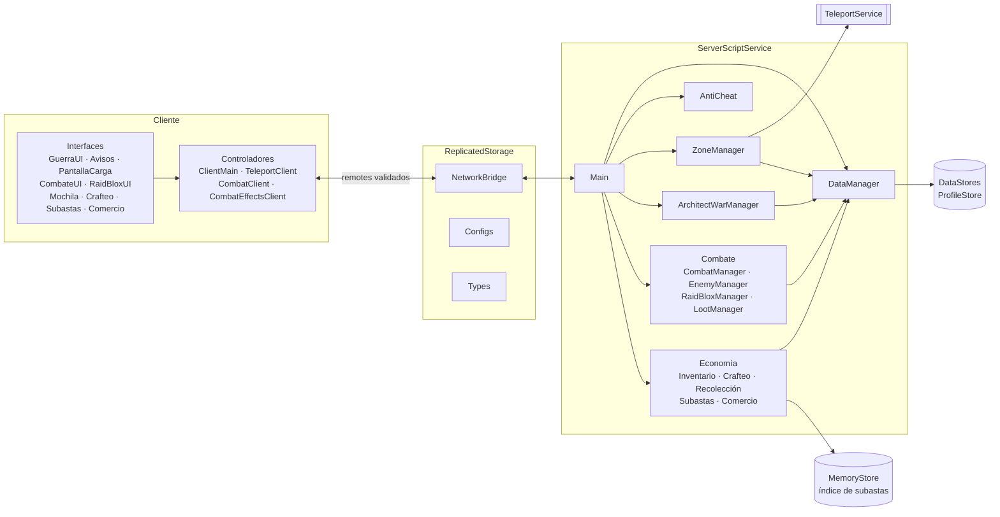

# RAIDBLOX

MMORPG multiplataforma (PC, móviles y consolas) para Roblox, inspirado en los clásicos del género.
Todo el código está en Luau con tipado estricto (`--!strict`) y sigue un modelo **server-authoritative**:
el cliente solo pide y muestra; el servidor valida y decide.

## Estado

| Fase | Contenido | Estado |
| --- | --- | --- |
| 1 | Guardado de datos, red segura, anti-cheat | ✅ Lista |
| 2 | Zonas y teletransporte, Guerra de Arquitectos | ✅ Lista |
| 3 | Combate tab-targeting, 8 clases, jefes RaidBlox, rarezas | ✅ Lista |
| 4 | Inventario, crafteo, subastas y comercio | ✅ Lista |
| 5 | Voz, misiones, hermandades y dungeons | ⏳ Siguiente |
| 6 | Monetización y cosméticos | Pendiente |
| 7 | HUD, combat text, minimapa y panel de admin | Pendiente |

Detalle por fase y pendientes en [docs/roadmap.md](docs/roadmap.md).

## Vista general

## Documentación

- [Instalación y pruebas](docs/instalacion.md): cómo cargar el proyecto en Studio y qué probar.
- [Arquitectura](docs/arquitectura.md): estructura de carpetas, módulos, dependencias y arranque.
- [Datos del jugador](docs/datos.md): esquema del perfil, sesión, migraciones y buzón offline.
- [Red y seguridad](docs/red-y-seguridad.md): NetworkBridge, rate limiting, validación y anti-cheat.
- [Zonas y teletransporte](docs/zonas.md): portales, pantalla de carga y validaciones de llegada.
- [Guerra de Arquitectos](docs/guerra-arquitectos.md): ciclo de partida, recursos, construcción y recompensas.
- [Combate](docs/combate.md): máquina de estados, 8 clases, enemigos, RaidBlox, rarezas y botín.
- [Chatarrero](docs/chatarrero.md): novena clase, 30 habilidades en 4 barras, Spoil y construcciones.
- [Economía](docs/economia.md): inventario, profesiones, crafteo, recolección, Casa de Subastas y comercio 1v1.
- [Bandos](docs/bandos.md): Violeta, Rojo y Azul, PvP y cambio de bando.
- [Misiones](docs/misiones.md): NPCs, objetivos y marcadores.
- [Grupos](docs/grupos.md): party de hasta 5.
- [Hermandades](docs/hermandades.md): rangos, permisos, banco de 4 pestañas y registro.
- [Chat de voz](docs/voz.md): canales de proximidad, grupo, hermandad y zona.
- [Mazmorras](docs/mazmorras.md): instancias para grupos, salas, jefe y modos local/reservado.
- [Monetización](docs/monetizacion.md): pases, tienda, cajas, pase de batalla, transmog y mascotas.
- [Interfaz y administración](docs/interfaz.md): HUD, ajustes y zurdos, minimapa, panel de admin y webhook.
- [Roadmap](docs/roadmap.md): fases, decisiones y pendientes.

## Inicio rápido

1. Instalá [Rojo](https://rojo.space) y su plugin de Studio (o cargá los scripts a mano: ver [instalación](docs/instalacion.md)).
2. `rojo serve` en la raíz del repo (o `./rojo.exe serve` si tenés el ejecutable en la carpeta) y conectá desde Studio.
3. Publicá el place y activá *Game Settings > Security > Enable Studio Access to API Services*.
4. Play: en Output tiene que aparecer `[RaidBlox] Servidor iniciado - Fase 4 (zona: Pruebas)`.

## Herramientas

| Herramienta | Uso | Config |
| --- | --- | --- |
| [Rojo](https://rojo.space) | Sincroniza `src/` con Studio | `default.project.json` |
| [luau-lsp](https://github.com/JohnnyMorganz/luau-lsp) | Chequeo de tipos `--!strict` | — |
| [Selene](https://github.com/Kampfkarren/selene) | Lint | `selene.toml` |
| [StyLua](https://github.com/JohnnyMorganz/StyLua) | Formato | `stylua.toml` |

## Dependencias de terceros

- [ProfileStore](https://github.com/MadStudioRoblox/ProfileStore) de loleris (Apache 2.0), incluido en
  `src/ServerScriptService/Packages/` junto con su licencia.
