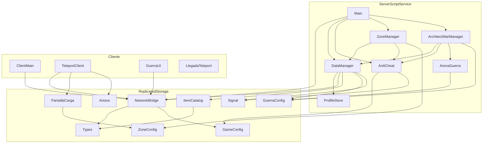
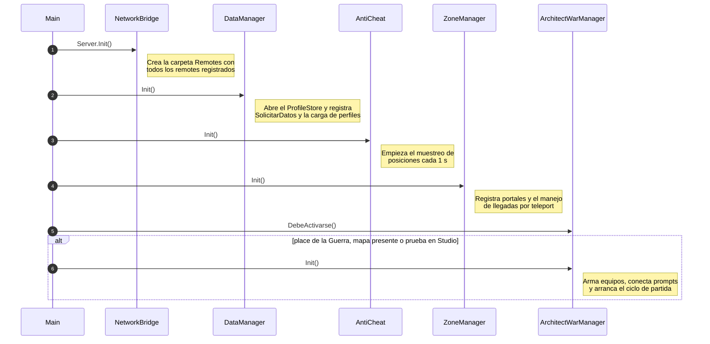

# Arquitectura

## Principios

1. **El servidor es la autoridad.** Oro, inventario, daño, progreso y compras se calculan y guardan solo en el servidor.
   El cliente pide acciones y muestra el resultado.
2. **Todo argumento del cliente es hostil.** Cada remote valida tipo, rango, permiso y plausibilidad antes de actuar.
3. **Un solo dueño por responsabilidad.** Solo `DataManager` toca DataStores; solo `NetworkBridge` crea remotes;
   cada sistema expone una API y el resto la usa.
4. **ModuleScripts, no `_G`.** Un único `Script` de servidor (`Main`) inicializa los sistemas en orden.
5. **`--!strict` en todos los archivos**, con tipos compartidos en `Shared/Types`.

## Estructura de carpetas

```text
src/
├── ReplicatedFirst/
│   └── LlegadaTeleport.client.luau   Pantalla de carga al llegar por teleport
├── ReplicatedStorage/
│   ├── Shared/Types.luau             Tipos compartidos (perfil, respuestas, secciones)
│   ├── Configs/
│   │   ├── GameConfig.luau           Constantes globales (datos, red, anti-cheat, progresión)
│   │   ├── ItemCatalog.luau          Definición de ítems
│   │   ├── ZoneConfig.luau           Zonas/places, nivel mínimo y temas de carga
│   │   └── GuerraConfig.luau         Balance de la Guerra de Arquitectos
│   └── Modules/
│       ├── NetworkBridge.luau        Remotes, rate limiting, timeout y validadores (Guard)
│       ├── Signal.luau               Eventos tipados entre módulos del mismo lado
│       ├── PantallaCarga.luau        Construcción de la pantalla de carga temática
│       └── Avisos.luau               Mensajes cortos en pantalla
├── ServerScriptService/
│   ├── Main.server.luau              Arranque del servidor
│   ├── Packages/ProfileStore.luau    Librería de persistencia (Apache 2.0)
│   └── Systems/
│       ├── DataManager.luau          Perfiles, oro, ítems, XP, honor, buzón
│       ├── AntiCheat.luau            Speedhack y vuelo
│       ├── ZoneManager.luau          Portales y TeleportService
│       └── Guerra/
│           ├── ArenaGuerra.luau      Mapa, planos holográficos y construcción
│           └── ArchitectWarManager.luau  Lógica de la partida
└── StarterPlayer/StarterPlayerScripts/
    ├── ClientMain.client.luau        Espejo local de los datos del jugador
    ├── TeleportClient.client.luau    Pantalla de carga y avisos
    └── GuerraUI.client.luau          Interfaz de la Guerra de Arquitectos
```

Convención de Rojo: `.server.luau` → `Script`, `.client.luau` → `LocalScript`, `.luau` → `ModuleScript`.

## Dependencias entre módulos



Las flechas van de quien usa a quien es usado. No hay dependencias circulares.

## Arranque del servidor

`Main.server.luau` inicializa los sistemas en un orden fijo, porque cada uno depende del anterior:



## Comunicación cliente ↔ servidor

| Remote | Tipo | Dirección | Uso |
| --- | --- | --- | --- |
| `DatosIniciales` | Event | S → C | Snapshot completo al cargar el perfil |
| `DataSync` | Event | S → C | Cambio de una sección (`Oro`, `Inventario`, `Nivel`...) |
| `Notificacion` | Event | S → C | Mensaje para mostrar en pantalla |
| `TeleportEstado` | Event | S → C | `Iniciando`, `Reintentando`, `Simulado`, `Fallo` |
| `GuerraEstado` | Event | S → C | Estado de la partida (cada segundo y en cada cambio) |
| `GuerraCarga` | Event | S → C | Recursos que lleva el jugador |
| `SolicitarDatos` | Function | C → S | Respaldo para pedir el snapshot |
| `MoverItem`, `UsarItem`, `Atacar` | Event | C → S | Reservados para las fases 3 y 4 |

La recolección y el depósito de la Guerra no usan remotes: van por `ProximityPrompt`, cuyos eventos se reciben en el servidor.

Ver [red y seguridad](red-y-seguridad.md) para el detalle de validación.
