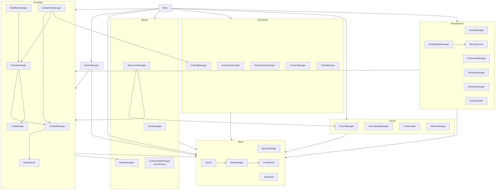

# Arquitectura

## Principios

1. **El servidor es la autoridad.** Oro, inventario, daño, progreso y compras se calculan y guardan solo en el servidor.
   El cliente pide acciones y muestra el resultado.
2. **Todo argumento del cliente es hostil.** Cada remote valida tipo, rango, permiso y plausibilidad antes de actuar.
3. **Un solo dueño por responsabilidad.** Solo `DataManager` toca el perfil del jugador; solo `NetworkBridge` crea
   remotes; cada sistema expone una API y el resto la usa.
4. **ModuleScripts, no `_G`.** Un único `Script` de servidor (`Main`) inicializa los sistemas en orden.
5. **`--!strict` en todos los archivos**, con tipos compartidos en `Shared/Types`.
6. **Los números viven en `Configs/`.** Balance, precios, recargas y textos se cambian ahí, sin tocar la lógica.
7. **Lo que cruza DataStores lleva diario.** Subastas, banco de hermandad y compras anotan la operación en el perfil
   antes de escribir en otro lado, y la reconcilian al entrar.

## Estructura de carpetas

```text
src/
├── ReplicatedFirst/
│   └── LlegadaTeleport.client.luau   Pantalla de carga al llegar por teleport
├── ReplicatedStorage/
│   ├── Shared/Types.luau             Tipos compartidos (perfil, respuestas, secciones)
│   ├── Configs/
│   │   ├── GameConfig.luau           Constantes globales (datos, red, anti-cheat, progresión, bandos)
│   │   ├── ItemCatalog.luau          Definición de ítems
│   │   ├── ItemRarityConfig.luau     Rarezas, efectos secundarios y pasivas
│   │   ├── ZoneConfig.luau           Zonas/places, nivel mínimo, temas de carga y mapas
│   │   ├── GuerraConfig.luau         Balance de la Guerra de Arquitectos y skins del castillo
│   │   ├── HabilidadTipos.luau       Tipos de habilidad y efecto (los comparten todas las clases)
│   │   ├── ClassConfig.luau          Clases, stats por nivel y habilidades
│   │   ├── ChatarreroConfig.luau     Las 30 habilidades del Chatarrero, Spoil y construcciones
│   │   ├── NpcArquetiposConfig.luau  Los 39 arquetipos de NPC y sus facciones
│   │   ├── ConsumiblesConfig.luau    Consumibles con efecto y mejoras temporales
│   │   ├── ForjaConfig.luau          Durabilidad, reparación, desencantar, reforjar y gemas (reglas puras)
│   │   ├── VaultConfig.luau          Bóveda global: pestañas, precios y puntos de acceso
│   │   ├── VisualConfig.luau         Animación y efectos de cada habilidad
│   │   ├── EnemigosConfig.luau       Enemigos, spawns y botín
│   │   ├── RaidBloxConfig.luau       Jefes de mundo
│   │   ├── MazmorrasConfig.luau      Mazmorras: salas, jefe y recompensas
│   │   ├── MisionesConfig.luau       Misiones y sus NPCs
│   │   ├── ProfesionesConfig.luau    Profesiones, recetas, estaciones y nodos
│   │   ├── MonetizacionConfig.luau   Pases, productos, cajas y monturas
│   │   ├── PaseBatallaConfig.luau    Pase de batalla (50 niveles) y códigos de creador
│   │   ├── MascotasConfig.luau       Mascotas coleccionistas
│   │   ├── AparienciaConfig.luau     Género del personaje
│   │   └── AparienciaEquipoConfig.luau  Modelos del equipo visible y apariencias (transmog)
│   └── Modules/
│       ├── NetworkBridge.luau        Remotes, rate limiting, timeout y validadores (Guard)
│       ├── Signal.luau               Eventos tipados entre módulos del mismo lado
│       ├── Pruebas.luau              ¿Hay que crear el contenido de prueba?
│       ├── AspectoPiedra.luau        Material y color de la piedra del castillo
│       ├── EstadoCliente.luau        Espejo local de los datos (cliente)
│       ├── EventosCliente.luau       Señales entre scripts del cliente
│       ├── Hud.luau                  Escala del HUD y ajustes de interfaz (cliente)
│       ├── UIKit.luau                Piezas de interfaz compartidas (cliente)
│       ├── MenuLateral.luau          Columna de botones (cliente)
│       ├── Avisos.luau               Mensajes cortos en pantalla (cliente)
│       ├── Radar.luau                Entidades del minimapa y del mapa (cliente)
│       ├── Apuntado.luau             Modo mira (cliente)
│       ├── ItemInfo.luau             Descripción de ítems (cliente)
│       └── PantallaCarga.luau        Pantalla de carga temática (cliente)
├── ServerScriptService/
│   ├── Main.server.luau              Arranque del servidor
│   ├── Packages/ProfileStore.luau    Librería de persistencia (Apache 2.0)
│   └── Systems/
│       ├── DataManager.luau          Perfiles: oro, ítems, XP, ajustes, diarios, buzón
│       ├── Buzon.luau                Envíos durables al buzón (ids fijos, reintentos)
│       ├── ConfigServidor.luau       Permisos y secretos que el cliente no ve (admins, webhook)
│       ├── AntiCheat.luau            Speedhack y vuelo
│       ├── ZoneManager.luau          Portales y TeleportService
│       ├── BandoManager.luau         Violeta / Rojo / Azul y reglas de PvP
│       ├── AparienciaManager.luau    Género del personaje y ajustes del jugador
│       ├── EquipoVisible.luau        Dibuja el equipo puesto y el transmog
│       ├── NpcFactory.luau           Modelos de NPC
│       ├── NpcManager.luau           NPCs por arquetipo: facciones, vendedores, servicios y Guardián de Portales
│       ├── MisionManager.luau        Misiones
│       ├── GrupoManager.luau         Grupos (party) de hasta 5
│       ├── HermandadManager.luau     Hermandades, rangos y banco
│       ├── VozManager.luau           Canales de voz
│       ├── MazmorraManager.luau      Mazmorras instanciadas
│       ├── AdminManager.luau         Panel de administración, baneos y webhook
│       ├── DebugStudio.luau          Comandos de prueba (solo Studio)
│       ├── Guerra/
│       │   ├── ArenaGuerra.luau          Mapa, planos holográficos y construcción
│       │   └── ArchitectWarManager.luau  Lógica de la partida
│       ├── Combate/
│       │   ├── Estadisticas.luau      Stats por clase, nivel y equipo
│       │   ├── CombatManager.luau     Máquina de estados, habilidades, efectos, parry
│       │   ├── EnemyManager.luau      IA por amenaza y recompensas
│       │   ├── RaidBloxManager.luau   Jefes de mundo
│       │   ├── LootManager.luau       Rarezas y botín personal
│       │   ├── ChatarreroManager.luau Spoil, construcciones y barras del Chatarrero
│       │   └── BuffManager.luau       Elixires, tónicos, infusiones y mejoras temporales de NPC
│       ├── Economia/
│       │   ├── InventarioManager.luau   Acciones de inventario y pociones
│       │   ├── CraftingManager.luau     Estaciones y recetas
│       │   ├── VaultManager.luau        Bóveda global: depósito, retiro, pestañas y puntos de acceso
│       │   ├── ForjaManager.luau        Desgaste del equipo y servicios de herrería de los NPC
│       │   ├── RecoleccionManager.luau  Nodos y minijuego
│       │   ├── AuctionManager.luau      Casa de Subastas
│       │   └── TradeManager.luau        Comercio 1v1
│       ├── Monetizacion/
│       │   ├── Bonos.luau               Multiplicadores de XP y oro (VIP, booster)
│       │   ├── PasesManager.luau        Pases permanentes
│       │   ├── ProductosManager.luau    Compras repetibles y cajas (ProcessReceipt)
│       │   ├── MonturaManager.luau      Monturas
│       │   ├── PaseBatallaManager.luau  Pase de batalla y códigos
│       │   ├── Recompensas.luau         Entrega de recompensas
│       │   └── MascotaManager.luau      Mascotas coleccionistas
│       └── Pruebas/
│           ├── NpcsPrueba.luau          Banquero y Mercader de prueba
│           └── EditorPiedra.luau        NPC Cantero
└── StarterPlayer/
    ├── StarterCharacterScripts/Health.server.luau  Reemplaza la regeneración por defecto de Roblox
    └── StarterPlayerScripts/
        ├── ClientMain.client.luau        Arranca el espejo local de los datos
        ├── TeleportClient.client.luau    Pantalla de carga y avisos
        ├── CombatClient.client.luau      Targeting, HUD, barras de acción, selector de clase
        ├── CombatEffectsClient.client.luau  Números flotantes, barra del jefe, botín
        ├── VisualesCombate.client.luau   Animaciones y efectos de las habilidades
        ├── MiraUI.client.luau            Modo mira
        ├── AuraBando.client.luau         Anillo del color del bando
        ├── MinimapaUI.client.luau        Minimapa circular
        ├── MapaMundoUI.client.luau       Mapa del mundo (M)
        ├── PersonajeUI.client.luau       Clase, bando, género y ajustes de interfaz
        ├── ChatUI.client.luau            Chat propio, movible
        ├── InventarioUI.client.luau      Mochila, equipo y detalles
        ├── CrafteoUI.client.luau         Recetas y minijuego de recolección
        ├── NpcUI.client.luau             Ventana de los NPCs por arquetipo (venta, servicios, viajes)
        ├── VaultUI.client.luau           Bóveda global: pestañas, buscador, filtros y mochila
        ├── SubastaUI.client.luau         Casa de Subastas
        ├── ComercioUI.client.luau        Comercio 1v1
        ├── MisionesUI.client.luau        Diálogos, seguimiento y marcadores
        ├── GrupoUI.client.luau           Grupo
        ├── HermandadUI.client.luau       Hermandad y su banco
        ├── VozUI.client.luau             Canales de voz
        ├── MazmorraUI.client.luau        Estado de la mazmorra
        ├── GuerraUI.client.luau          Guerra de Arquitectos
        ├── TiendaUI.client.luau          Tienda, pase de batalla, colección y códigos
        ├── MonturaChatUI.client.luau     Montura y etiqueta VIP del chat
        ├── AdminUI.client.luau           Panel de administración
        ├── TiendaPruebaUI.client.luau    Mercader de prueba
        └── EditorPiedraUI.client.luau    Ventana del Cantero
```

Convención de Rojo: `.server.luau` → `Script`, `.client.luau` → `LocalScript`, `.luau` → `ModuleScript`.
Toda la interfaz se crea por código en `PlayerGui`: no hay nada que armar en `StarterGui`.

## Dependencias entre sistemas



Las flechas van de quien usa a quien es usado. No hay dependencias circulares: cuando un sistema de abajo necesita
avisarle a uno de arriba, usa una señal (`Signal`) o un gancho (`CraftingManager.SetDuplicador`,
`CombatManager.RegistrarEspecial`, `BandoManager.SetEnCombate`).

## Arranque del servidor

`Main.server.luau` inicializa los sistemas en un orden fijo, porque cada uno depende de los anteriores:

1. **Red:** `NetworkBridge.Server.Init()` crea la carpeta `Remotes` con todos los remotes registrados.
2. **Datos:** `DataManager.Init()` abre el ProfileStore y empieza a cargar perfiles.
3. **Seguridad:** `AntiCheat.Init()`.
4. **Mundo:** `ZoneManager.Init()` (portales y llegadas). La zona del place queda en el atributo `Zona` de Workspace.
5. **Bandos, apariencia y combate:** `BandoManager`, `AparienciaManager`, `CombatManager`, `LootManager`,
   `EnemyManager` y `RaidBloxManager` (enemigos y jefes de la zona).
6. **Economía:** inventario, crafteo, recolección, subastas y comercio.
7. **Social, mazmorras, monetización y clases:** `GrupoManager`, `HermandadManager`, `VozManager`,
   `MazmorraManager`, `PasesManager`, `MonturaManager`, `ProductosManager`, `PaseBatallaManager`, `MascotaManager`,
   `EquipoVisible`, `AdminManager`, `ChatarreroManager`, `BuffManager`, `NpcManager`, `VaultManager`, `ForjaManager` y `MisionManager`.
8. **Modo de juego del place:** `ArchitectWarManager.Init()` si corresponde.
9. **Herramientas de prueba:** `DebugStudio` (solo Studio), `NpcsPrueba` y `EditorPiedra`.

Al terminar imprime `[RaidBlox] Servidor iniciado (zona: ...)`.

## Comunicación cliente ↔ servidor

Todos los remotes se declaran en la tabla `DEFINICIONES` de `NetworkBridge` (esta lista sale de ahí). Los `Function`
devuelven siempre `{ Success, ErrorCode, Data }`.

| Grupo | Remotes | Tipo | Dirección |
| --- | --- | --- | --- |
| Servidor -> cliente | `DatosIniciales`, `DataSync`, `Notificacion`, `TeleportEstado`, `GuerraEstado`, `GuerraCarga` | Event | S → C |
| Cliente -> servidor | `SolicitarDatos` | Function | C → S |
| Fase 4: inventario | `MoverItem`, `UsarItem`, `DividirPila` | Event | C → S |
| Fase 4: inventario | `DestruirItem` | Function | C → S |
| Fase 4: crafteo y recolección | `CraftearIniciar` | Function | C → S |
| Fase 4: crafteo y recolección | `CrafteoAbrir`, `CrafteoEstado`, `MinijuegoRecoleccion` | Event | S → C |
| Fase 4: crafteo y recolección | `RecoleccionGolpe` | Event | C → S |
| Fase 5: grupos | `GrupoEstado`, `GrupoInvitacion` | Event | S → C |
| Fase 5: grupos | `GrupoInvitar`, `GrupoResponder`, `GrupoSalir`, `GrupoExpulsar`, `GrupoLider` | Function | C → S |
| Pruebas: editor de la piedra del castillo | `EditorPiedraAbrir` | Event | S → C |
| Pruebas: editor de la piedra del castillo | `EditorPiedraGuardar` | Function | C → S |
| Fase 6: tienda, pases y monturas | `TiendaInfo`, `TiendaComprarPase`, `TiendaGuardarTitulo`, `MonturaAlternar`, `TiendaProductos`, `TiendaComprarProducto`, `TiendaUsarReroll`, `TiendaUsarBando`, `PaseInfo`, `PaseReclamar`, `CanjearCodigo`, `EquiparSkinCastillo`, `EquiparTransmog`, `EquiparMascota` | Function | C → S |
| Fase 6: tienda, pases y monturas | `TiendaCajaAbierta` | Event | S → C |
| Chatarrero | `BarraAlternar`, `ChatarreroDesmantelar` | Function | C → S |
| Chatarrero | `ChatarreroOlfato` | Event | S → C |
| Fase 7.4: panel de administración (el servidor valida que seas admin) | `AdminAccion`, `AdminInfo` | Function | C → S |
| Fase 5: mazmorras | `MazmorraEstado` | Event | S → C |
| Fase 5: mazmorras | `MazmorraSalir` | Function | C → S |
| Fase 5: voz | `VozEstado` | Event | S → C |
| Fase 5: voz | `VozCanal` | Function | C → S |
| Fase 5: hermandades (DataStore: timeouts largos) | `HermandadCambio`, `HermandadInvitacion` | Event | S → C |
| Fase 5: hermandades (DataStore: timeouts largos) | `HermandadCrear`, `HermandadInfo`, `HermandadInvitar`, `HermandadResponder`, `HermandadSalir`, `HermandadDisolver`, `HermandadExpulsar`, `HermandadRango`, `HermandadTransferir`, `HermandadPermiso`, `HermandadBanco`, `HermandadDepositarItem`, `HermandadRetirarItem`, `HermandadDepositarOro`, `HermandadRetirarOro` | Function | C → S |
| Fase 5: misiones | `MisionDialogo` | Event | S → C |
| Fase 5: misiones | `MisionAceptar`, `MisionEntregar`, `MisionAbandonar` | Function | C → S |
| Bandos y ajustes del jugador | `BandoElegir`, `GuardarAjuste` | Function | C → S |
| Pruebas: NPCs de oro y materiales (solo con Pruebas.Activas()) | `TiendaPruebaAbrir` | Event | S → C |
| Pruebas: NPCs de oro y materiales (solo con Pruebas.Activas()) | `TiendaPruebaComprar` | Function | C → S |
| NPCs por arquetipo | `NpcAbrir` | Event | S → C |
| NPCs por arquetipo | `NpcComprar`, `NpcVender`, `NpcServicio`, `NpcSobreItem`, `NpcFabricar`, `NpcViajar` | Function | C → S |
| Bóveda global | `VaultAbrir` | Event | S → C |
| Bóveda global | `VaultDepositar`, `VaultRetirar`, `VaultMover`, `VaultExpandir`, `VaultPersonalizar` | Function | C → S |
| Fase 4: Casa de Subastas | `SubastaAbrir` | Event | S → C |
| Fase 4: Casa de Subastas | `SubastaBuscar`, `SubastaPublicar`, `SubastaComprar`, `SubastaCancelar`, `SubastaMias` | Function | C → S |
| Fase 4: comercio 1v1 | `ComercioSolicitar`, `ComercioResponder`, `ComercioOfertar`, `ComercioBloquear`, `ComercioConfirmar`, `ComercioCancelar` | Event | C → S |
| Fase 4: comercio 1v1 | `ComercioInvitacion`, `ComercioEstado` | Event | S → C |
| Fase 3: combate y botín | `UsarHabilidad`, `Parry`, `RecogerBotin` | Event | C → S |
| Fase 3: combate y botín | `ElegirClase`, `EquiparItem`, `DesequiparItem` | Function | C → S |
| Fase 3: combate y botín | `CombateEvento`, `HabilidadEstado`, `RaidBloxEstado`, `AnuncioGlobal`, `BotinSoltado`, `BotinRetirado` | Event | S → C |

La recolección, las estaciones, los NPCs y el depósito de la Guerra no usan remotes para empezar: van por
`ProximityPrompt`, cuyos eventos se reciben en el servidor.

Ver [red y seguridad](red-y-seguridad.md) para el detalle de validación.
