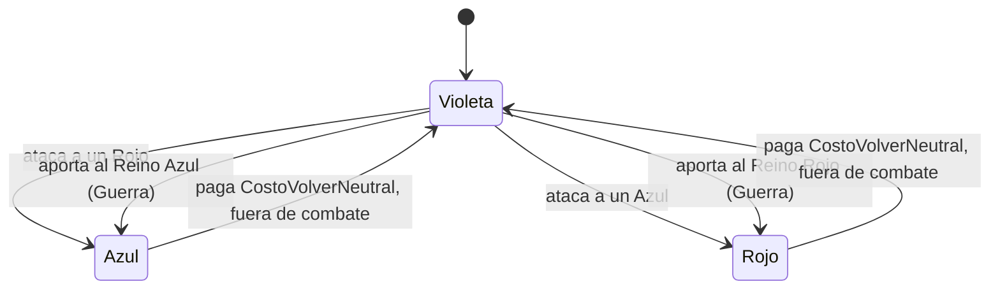

# Bandos, PvP y apariencia

## Bandos

Todo jugador empieza **Violeta** (neutral). Los bandos se guardan en el perfil (`DatosJugador.Faccion`, datos v4) y se
replican como atributo `Bando` del jugador (color del nombre y del marco de vida).

| Bando | Reglas |
|---|---|
| 🟣 Violeta | Neutral. **Nadie lo puede atacar.** Puede atacar a Rojos y Azules en contexto PvP, y al hacerlo cambia de bando. |
| 🔴 Rojo | Pelea contra Azules en contexto PvP. |
| 🔵 Azul | Pelea contra Rojos en contexto PvP. |

**Contexto PvP**: dentro de una parte con la etiqueta `ZonaPvP`, en una zona con `PvP = true` en `ZoneConfig`, o
jugando una partida de la Guerra de Arquitectos (atributo `EnGuerra`). En modo de pruebas hay una **Arena PvP** al
oeste del spawn.

- Volver a Violeta cuesta `GameConfig.Bandos.CostoVolverNeutral` de oro (5000), no se puede en combate (10 s desde el
  último golpe) ni durante una partida de la Guerra.
- En la Guerra, Rojos y Azules juegan para su reino; los Violeta se reparten para emparejar los equipos y, al aportar,
  quedan en ese bando.
- Las curas de área y en un aliado no alcanzan a jugadores del bando rival. Un Violeta tampoco puede curar ni
  potenciar a un jugador que está en contexto PvP (sería intocable y decisivo a la vez).
- El daño en el tiempo entre jugadores se corta si dejan de poder pelear (por ejemplo, si la víctima sale de la zona).
- En la Guerra no se puede atacar ni convertir a un compañero de equipo.
- Volver a Violeta pide confirmación (dos clics).

Módulos: `Systems/BandoManager` (reglas, arena de prueba, remote `BandoVolverNeutral`) y `CombatManager`
(`puedeAtacar`, `enemigosEnRadio`, `aliadosEnRadio`; convierte al Violeta al concretar el ataque).

## Panel Personaje

Botón **Personaje** (a la izquierda, debajo del chat):

- **Clase**: abre el selector. En modo de pruebas se cambia libremente; fuera de pruebas, solo la primera vez.
- **Bando**: muestra el actual y el botón para volver a Violeta.
- **Género**: *Mi avatar* (sin cambios), *Masculino* o *Femenino*. Lo aplica `AparienciaManager` con
  `HumanoidDescription` (proporciones de `AparienciaConfig`; ahí se pueden poner ids de partes del Catálogo).
- **Chat**: posición (izquierda/derecha), tamaño (chico/normal/grande) y mostrar/minimizar, sobre la ventana de chat
  de Roblox (`ChatWindowConfiguration`).

Todo se guarda en `DatosJugador.Ajustes` con el remote `GuardarAjuste`, que valida clave y valor contra una lista
cerrada.

## Aura de bando

Cada jugador tiene un anillo de luz en el piso del color de su bando
(`GameConfig.Bandos.Colores`). Lo dibuja cada cliente para todos los jugadores
(`AuraBando.client.luau`), así lo ven todos sin tráfico de red. El anillo son
24 tramos de neón, y cada uno se apoya donde pega un rayo hacia abajo, así
sigue rampas, escalones y terreno. No se dibuja para jugadores muertos, a más de
150 studs, ni para un pícaro invisible (salvo el tuyo).
