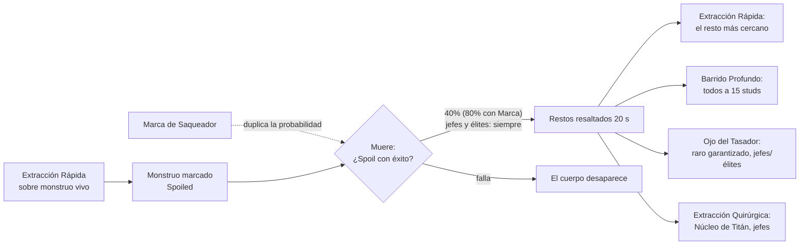

# Chatarrero (novena clase)

Saqueador y artesano de campo. Usa **Stamina** (la misma barra que el maná de
las otras clases, en amarillo) y tiene **30 habilidades**, de las que equipa 16
en **4 barras de 4 botones**, una por categoría de recarga.

| Archivo | Lado | Qué tiene |
|---|---|---|
| `Configs/ChatarreroConfig.luau` | Compartido | Las 30 habilidades y los números del Spoil y las construcciones |
| `Configs/HabilidadTipos.luau` | Compartido | Tipos de habilidad y efecto (los comparten todas las clases) |
| `Systems/Combate/ChatarreroManager.luau` | Servidor | Spoil, extracciones, construcciones, barras y desmantelar |
| `Systems/Combate/CombatManager.luau` | Servidor | Recargas, Stamina, daño y los efectos nuevos |
| `CombatClient.client.luau` | Cliente | Las 4 barras, teclas y la ventana "Habilidades" |

Se integró al combate que ya existía en vez de armar un sistema aparte: usa la
misma validación del servidor, la mira, el marco de objetivo y las reglas de
PvP por bandos.

## Barras y teclas

| Barra | Recarga | Teclas |
|---|---|---|
| I · Instantes | 2-3 s | 1 2 3 4 (gamepad: X Y B ↑) |
| II · Mid Spells | 2 min | Z X C V |
| III · Mid Ultis | 10 min | 7 8 9 0 |
| IV · Ultis Masivas | 20 min | Y U H J |

- **⚙ Habilidades (K)** abre la ventana para elegir 4 por barra. El servidor
  guarda la elección (`Barras` en el perfil) y solo deja usar lo equipado.
- No se puede mover de barra una habilidad que está en recarga (si no, se
  podría usar una ulti y cambiarla por otra lista).
- Las recargas de 60 s o más **sobreviven a morir, a cambiar de clase y a
  desconectarse** (`CooldownsLargos` en el perfil).
- En celular las barras son un bloque de 4 columnas; con gamepad, las barras
  II a IV se tocan en pantalla.

## Spoil

- Solo el Chatarrero que marcó al monstruo puede extraer, una vez por resto.
- Materiales nuevos: **Chatarra**, **Engranaje** y **Núcleo de Titán**
  (todavía no entran en ninguna receta).
- **Sobreaceleración**: 60 s con 50% de duplicar lo del Spoil, lo desmantelado
  y lo fabricado.
- Los restos llevan la etiqueta `RestosSpoil` (el minimapa y el Olfato la usan).

## Construcciones

| Qué | Dura | Detalle |
|---|---|---|
| Yunque Portátil | 60 s | Es un yunque normal para fabricar (cualquiera) y permite al dueño **desmantelar** equipo Común o Raro: devuelve la mitad de su receta, o Chatarra |
| Trampa de Oso | 60 s | Primer enemigo a 4 studs: inmóvil 3 s y sangrado |
| Pared de chatarra | 20 s | Corta el paso y las habilidades a distancia que la crucen |
| Torreta | 40 s | Dispara cada 2 s a hasta 5 enemigos a 25 studs |

## Efectos nuevos del combate

Disponibles para cualquier clase (`HabilidadTipos.Efecto`): Empujar,
Interrumpir, Recurso, Escudo (absorbe daño), IgnorarArmadura, Reduccion,
Silenciar, PerderAgro e Inmovilizar. Además: auras negativas (debuffs), áreas
en cono, `EfectosPropios` y habilidades `Especial` registradas con
`CombatManager.RegistrarEspecial`.

## Lo que quedó con un efecto parecido

El juego todavía no tiene **durabilidad del equipo** ni **banco personal**, así
que estas tres hacen algo parecido hasta que existan (campo `Pendiente`):

- **Kit de Remiendos**: +20% de defensa por 15 s (después: restaurar durabilidad).
- **Reingeniería de Emergencia**: reinicia la barra II y da +25% de defensa al
  grupo (después: reparar todo el equipo del grupo).
- **Llamado del Contrabandista**: el dron vende tu Chatarra a 1,5 veces su
  precio (después: llevar ítems al banco).

Otras adaptaciones: el empuje solo mueve monstruos comunes (no jefes ni
jugadores); "Apagón General" apaga el equipo como -30% de ataque, poder y
defensa; el desfibrilador revive en el lugar donde cayó a un compañero de grupo
(o a cualquiera que siga muerto) hasta 2 minutos después.

## Las 30 habilidades

### Barra I · Instantes (2-3 s)

| # | Habilidad | Calidad | Recarga | Stamina | Qué hace |
|---|---|---|---|---|---|
| 1 | Golpe de Palanca | Común | 2 s | 0 | Golpe cuerpo a cuerpo con la palanca. Genera poca amenaza. |
| 2 | Marca de Saqueador | Común | 3 s | 5 | Marca a un monstruo: duplica la probabilidad de que el Spoil tenga éxito cuando muera. |
| 3 | Extracción Rápida | Inusual | 3 s | 8 | Spoil Menor. Sobre un monstruo vivo: lo prepara para dejar restos al morir. Con restos tuyos a menos de 10 studs: les saca los materiales. |
| 4 | Varapalo Defensivo | Inusual | 3 s | 10 | Golpe rápido que empuja al enemigo y te da +15% de defensa por 4 s. |
| 5 | Olfato de Chatarrero | Rara | 3 s | 5 | Pasiva activa: por 20 s resalta las vetas de metal y los restos cercanos (150 studs). |
| 6 | Corte Preciso | Común | 2.5 s | 6 | Daño físico menor que baja 5% la defensa del objetivo por 8 s. |
| 7 | Bebida Energética Casera | Inusual | 3 s | 0 | Recupera 15 de Stamina al instante. |
| 8 | Lanzamiento de Tuercas | Común | 3 s | 8 | Proyectil rápido a distancia que interrumpe lo que el enemigo esté casteando. |

### Barra II · Mid Spells (2 min)

| # | Habilidad | Calidad | Recarga | Stamina | Qué hace |
|---|---|---|---|---|---|
| 9 | Barrido Profundo | Rara | 120 s | 20 | Spoil Masivo: saca los materiales de todos tus restos marcados a 15 studs. |
| 10 | Kit de Remiendos de Emergencia | Rara | 120 s | 20 | Remienda el equipo propio o de un aliado: +20% de defensa por 15 s. (Cuando exista la durabilidad, además la va a restaurar.) |
| 11 | Bomba de Humo Artesanal | Rara | 120 s | 25 | Nube de humo de 12 studs: ciega 2 s a los monstruos comunes y te deja en sigilo por 6 s. |
| 12 | Yunque Portátil | Épica | 120 s | 30 | Planta un yunque por 60 s. Sirve para fabricar como cualquier yunque y, a vos, para desmantelar equipo común o raro en materiales (menú del ítem en la mochila). |
| 13 | Trampa de Oso Mecánica | Inusual | 120 s | 20 | Deja una trampa por 60 s: el primer enemigo que la pisa queda inmóvil 3 s y sangra. |
| 14 | Estimulante de Adrenalina | Rara | 120 s | 15 | Te libera si estás inmovilizado y corrés 20% más rápido por 10 s. |
| 15 | Escudo de Chatarra Soldada | Épica | 120 s | 25 | Escudo que absorbe daño por 20 s. Crece con los metales que lleves en la mochila (hasta 60 piezas). |
| 16 | Negociación Turbia | Rara | 120 s | 15 | Confunde a un monstruo común: te deja de perseguir por 6 s. No funciona con jefes. |

### Barra III · Mid Ultis (10 min)

| # | Habilidad | Calidad | Recarga | Stamina | Qué hace |
|---|---|---|---|---|---|
| 17 | Ojo del Tasador | Épica | 600 s | 30 | Analiza los restos de un jefe o élite (a 12 studs): la extracción garantiza al menos un material raro. |
| 18 | Golpe del Artesano Maestro | Épica | 600 s | 35 | Martillazo de daño masivo que aturde 3 s. |
| 19 | Sobreaceleración de Producción | Legendaria | 600 s | 30 | Por 60 s, 50% de probabilidad de duplicar los materiales del Spoil y lo que fabriques. |
| 20 | Llamado del Contrabandista | Épica | 600 s | 20 | Un dron se lleva toda la Chatarra de tu mochila y te la paga a 1,5 veces su precio. (Cuando exista el banco personal, va a llevar ítems al banco.) |
| 21 | Sobrecarga de Pólvora | Épica | 600 s | 40 | Explosión en cono hacia adelante (16 studs): daña, empuja y baja 40% la defensa por 10 s. |
| 22 | Extracción Quirúrgica | Legendaria | 600 s | 30 | Saca un Núcleo de Titán (componente legendario) garantizado de los restos de un jefe de mazmorra o RaidBlox a 12 studs. |
| 23 | Catalizador Volátil | Épica | 600 s | 30 | Por 12 s tus golpes ignoran toda la defensa del enemigo. |
| 24 | Fortificación de Posición | Rara | 600 s | 25 | Levanta una pared de chatarra por 20 s: corta el paso y las habilidades a distancia que la crucen. |

### Barra IV · Ultis Masivas (20 min)

| # | Habilidad | Calidad | Recarga | Stamina | Qué hace |
|---|---|---|---|---|---|
| 25 | El Gran Botín | Legendaria | 1200 s | 40 | Por 30 s, cada monstruo que muere a 30 studs tuyos deja un cofre de materiales raros para quienes pelearon. |
| 26 | Apagón General | Legendaria | 1200 s | 50 | Desmantelamiento: a 20 studs, los enemigos quedan 6 s en silencio y con el equipo apagado (-30% ataque, poder y defensa). |
| 27 | Avatar del Titán de Hierro | Legendaria | 1200 s | 50 | Por 25 s crecés, recibís la mitad del daño, no te pueden aturdir y tenés +300% de ataque. |
| 28 | Resurrección por Desfibrilador | Legendaria | 1200 s | 50 | Revive con toda la vida a un aliado que cayó hace menos de 2 minutos a 30 studs tuyos, en el lugar donde cayó. |
| 29 | Reingeniería de Emergencia | Legendaria | 1200 s | 40 | Reinicia las recargas de tu barra II y da +25% de defensa por 20 s a los aliados a 30 studs. (Cuando exista la durabilidad, además va a reparar todo el equipo del grupo.) |
| 30 | El Legado del Rey de la Chatarra | Legendaria | 1200 s | 60 | Invoca una torreta-taller por 40 s que dispara cada 2 s a hasta 5 enemigos a 25 studs. |
