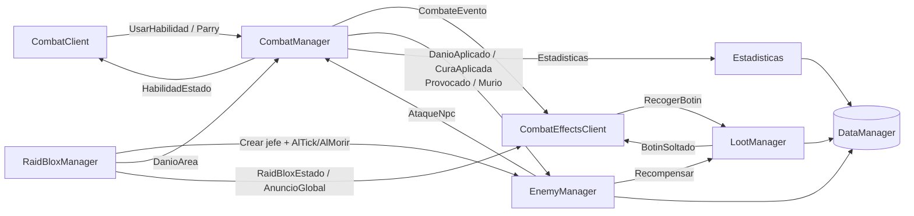
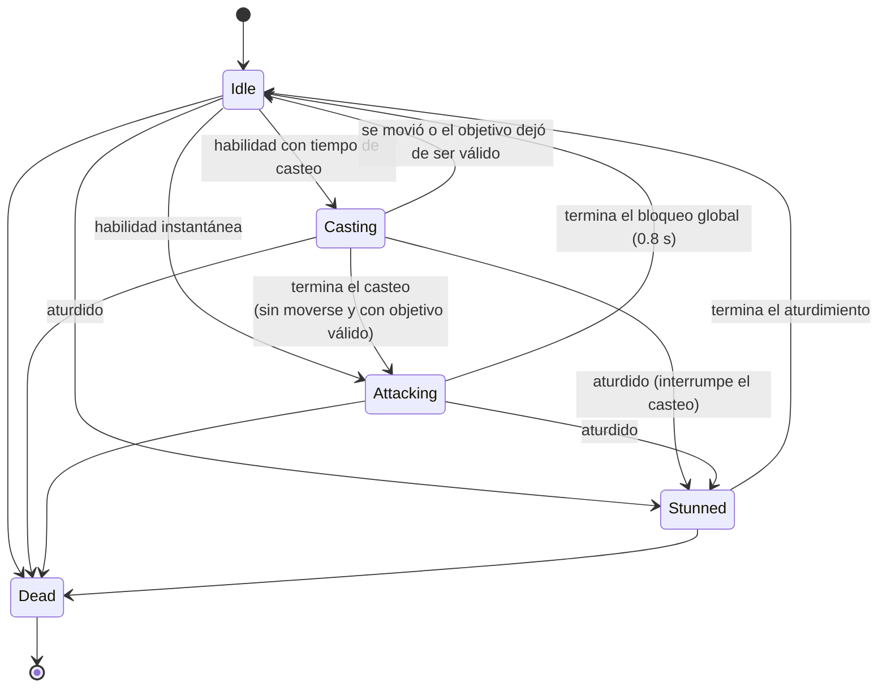
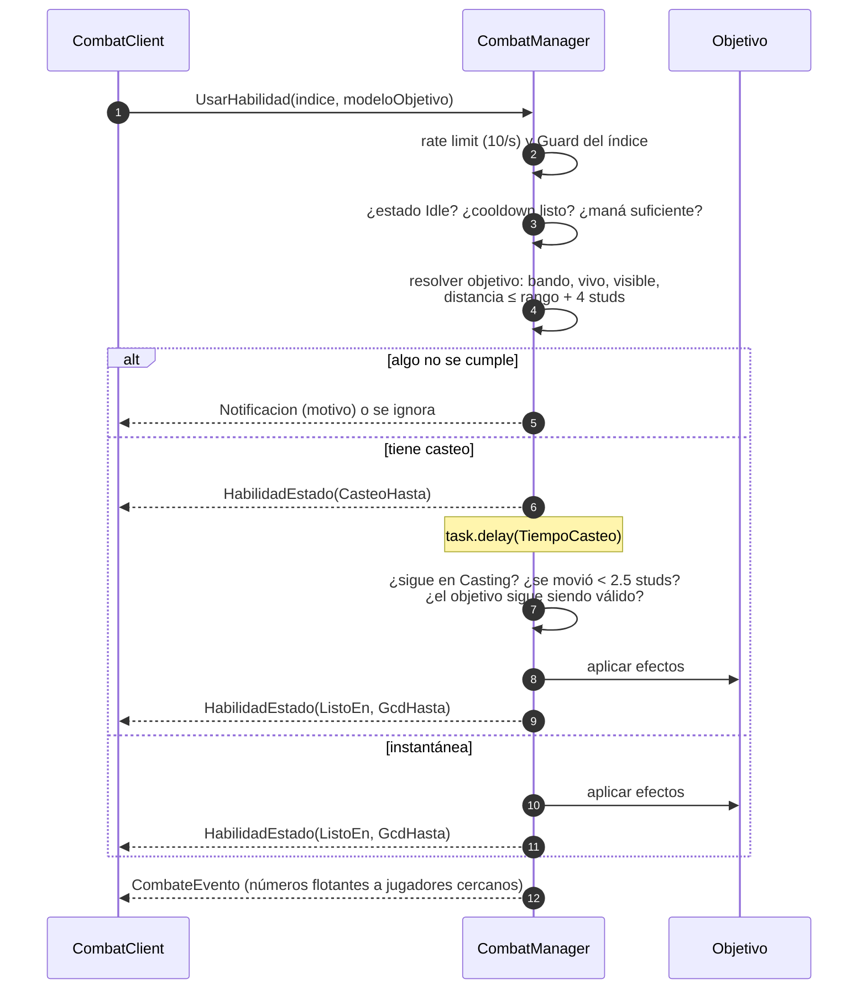
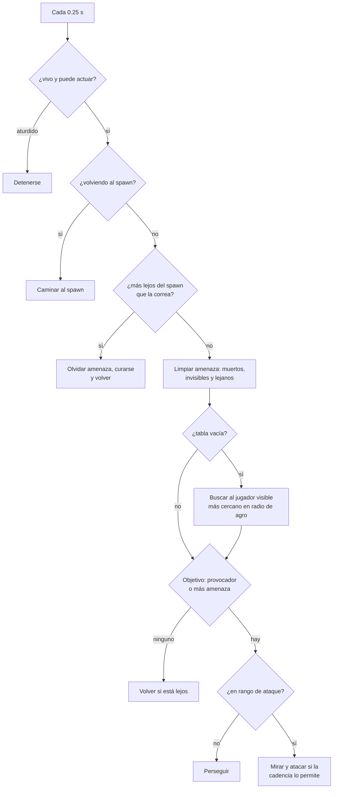
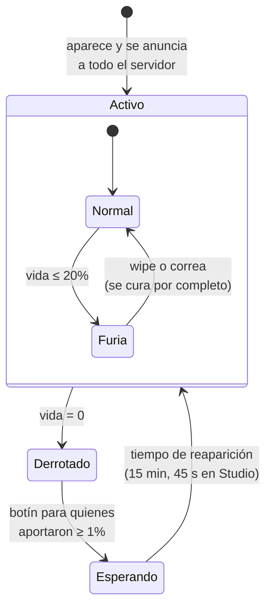
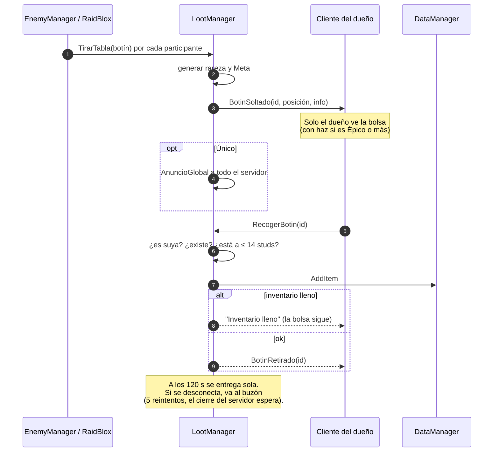

# Combate, clases, RaidBlox y rarezas

Combate **tab-targeting** 100% decidido en el servidor. El cliente solo pide "usar la habilidad N sobre este
objetivo" o "parry"; el servidor valida estado, cooldown, maná, rango y aplica los efectos.

## Módulos

| Módulo | Lado | Responsabilidad |
| --- | --- | --- |
| `ClassConfig` | Compartido | 8 clases, stats por nivel, 4 habilidades cada una |
| `ItemRarityConfig` | Compartido | Rarezas, efectos secundarios y pasivas |
| `EnemigosConfig` / `RaidBloxConfig` | Compartido | Enemigos, spawns, jefes y tablas de botín |
| `Estadisticas` | Servidor | Stats de combate: clase + nivel + equipo |
| `CombatManager` | Servidor | Máquina de estados, habilidades, daño, parry, efectos |
| `EnemyManager` | Servidor | IA de enemigos por amenaza, correa, recompensas |
| `RaidBloxManager` | Servidor | Jefes de mundo: escalado, furia, zonas rojas, barra |
| `LootManager` | Servidor | Generación con rareza, botín personal, recogida validada |
| `CombatClient` | Cliente | Targeting multiplataforma, barra de acción, selector de clase |
| `CombatEffectsClient` | Cliente | Números flotantes, barra del jefe, bolsas de botín, anuncios |

## Máquina de estados

Cada combatiente (jugador o NPC) tiene un estado. Solo se puede lanzar una habilidad en `Idle`.

Las transiciones por tiempo (fin del bloqueo y del aturdimiento) se resuelven al consultar el estado, comparando
contra `workspace:GetServerTimeNow()`. No hay `task.wait` para los cooldowns.

## Uso de una habilidad

## Fórmulas

| Concepto | Fórmula |
| --- | --- |
| Stat por nivel | `Base + PorNivel × (nivel − 1)` |
| Daño de habilidad | `(Base + Ataque o Poder × Factor) × multiplicadores × (1 − mitigación)` |
| Mitigación | `Defensa / (Defensa + 100)` |
| Crítico | ×1.5. El Asesino por la espalda: crítico seguro ×1.5 extra (×2.25) |
| Curación | `Base + Poder × Factor` (puede ser crítica) |
| Amenaza | daño × multiplicador de clase (Tanque ×3); curas: 0.5 por punto curado |
| Buffs (auras) | `stat × (1 + suma de % activos)`; la misma habilidad renueva, no acumula |
| Regeneración | maná por segundo según clase; vida 2%/s tras 6 s fuera de combate |

Equipamiento: cada ítem suma sus atributos multiplicados por su rareza (Fuerza → Ataque, Inteligencia → Poder,
Agilidad → +0.5% crítico por punto), más sus efectos secundarios y su pasiva.

## Parry

Ventana de **0.5 s** (tecla F, L1 o botón). Antes de cada golpe cuerpo a cuerpo, el enemigo muestra un **"¡!"**
y pega 0.45 s después: esa es la señal para hacer parry. Si el golpe llega dentro de la ventana, se anula, el daño
vuelve al agresor (mitigado por su propia defensa) y queda aturdido 1.5 s. Cooldown de 3 s. Los ataques de área de
los jefes no se pueden parar con parry: hay que salir de la zona roja.

## Aturdimientos

Tras terminar un aturdimiento, el combatiente queda **inmune 3 s** a nuevos aturdimientos (aparece "Inmune"). Los
RaidBlox además resisten la mitad de la duración. Así nadie (ni un jefe) puede quedar aturdido para siempre.

## Las 8 clases

| Clase | Rol | Habilidades (1 · 2 · 3 · 4) | Mecánica propia |
| --- | --- | --- | --- |
| Tanque | Defensor | Golpe Defensivo · Provocación · Terremoto · Muralla | Amenaza ×3, provoca |
| Guerrero | Daño cuerpo a cuerpo | Tajo · Golpe Brutal · Torbellino · Grito de Guerra | Aura de ataque al grupo |
| Mago | Daño mágico a distancia | Proyectil Arcano · Bola de Fuego · Nova de Escarcha · Meteoro | Casteos largos, área |
| Arquero | Daño físico a distancia | Disparo · Disparo Certero · Flecha Venenosa · Lluvia de Flechas | Daño en el tiempo |
| Asesino | Sigilo | Puñalada · Hoja Envenenada · Sombras · Ejecución | Invisibilidad, crítico por la espalda |
| Healer | Sanador | Castigo · Sanar · Renovar · Plegaria | Cura directa y en el tiempo |
| Druida | Sanador natural | Espinas · Rejuvenecer · Raíces · Florecer | Curas sostenidas, inmoviliza |
| Buffer | Apoyo | Golpe Rúnico · Aura de Fuerza · Aura de Protección · Inspiración | Auras de grupo |

Los números exactos (costos, cooldowns, rangos, fórmulas) están en `ClassConfig.luau`.

**Elegir clase:** la primera vez es gratis (selector al entrar). En Studio se puede cambiar libremente con el botón
"Clase [Studio]" para probar todas.

## Controles

| Acción | PC | Consola | Móvil |
| --- | --- | --- | --- |
| Siguiente enemigo | Tab | R2 | — |
| Enemigo anterior | — | L2 | — |
| Seleccionar | Clic | — | Tocar al enemigo o aliado |
| Limpiar objetivo | Clic en el vacío | — | Tocar el vacío |
| Habilidades 1–4 | 1 2 3 4 | X Y B ↑ | Botones de la barra |
| Parry | F | L1 | Botón Parry |

Si una habilidad de aliado se lanza sin aliado seleccionado, se lanza sobre uno mismo. Para que Tab funcione como
tecla de objetivo, la lista de jugadores de Roblox (que también usa Tab) se oculta. Moverse más de 2.5 studs durante un
casteo lo cancela en el momento.

## Enemigos e IA

Si pierde a todos sus objetivos (murieron o se volvieron invisibles) estando herido, se **reinicia por completo**:
vuelve al spawn con vida completa y olvida los aportes. Los muñecos de práctica no generan amenaza.

Al morir, cada jugador que aportó (daño o curas a quienes peleaban) recibe XP, oro y su propia tirada de botín.

## RaidBlox (jefes de mundo)

- **Escalado:** cada 3 s, `vida máxima = SaludBase × (1 + jugadores en 100 studs × 0.2)` (mínimo 1 jugador),
  manteniendo el porcentaje.
- **Wipe:** si mueren todos, el jefe vuelve con vida completa y sin Furia; los aportes se reinician.
- **Zonas rojas:** cada ataque de área marca el suelo antes de golpear (1.5–1.8 s). Salir del círculo evita el daño.
- **Furia (≤ 20%):** +30% de daño, ataques de área un 40% más seguidos y con un 25% menos de aviso.
- **Barra gigante** arriba de la pantalla para todos los que estén a menos de 250 studs.

| Jefe | Zona | Vida base | Ataques de área |
| --- | --- | --- | --- |
| Gólem de Obsidiana | Pruebas (Studio) | 4000 | Pisotón (alrededor, r16), Lluvia de Rocas (sobre un jugador, r9) |
| Reina Araña del Bosque | Bosque | 6000 | Nido de Veneno (sobre un jugador, r10) |

## Rarezas

| Rareza | Color | Multiplicador | Efectos secundarios | Extra |
| --- | --- | --- | --- | --- |
| Común | `#808080` | ×1.0 | — | — |
| Raro | `#0070DD` | ×1.3 | 1 | — |
| Épico | `#A335EE` | ×1.6 | 2 | Partículas y haz de luz |
| Místico | `#00F0FF` | ×2.0 | 2 | Pasiva única y haz de luz |
| Único | `#FFD700` | ×2.5 | 2 | Pasiva, aura, haz, anuncio global; solo de RaidBlox |

Efectos secundarios posibles: Crítico, Robo de vida, Regeneración de maná, Defensa, Ataque, Poder.
Pasivas: **Ejecutor** (+25% a objetivos con menos de 30% de vida), **Vampirismo** (8% del daño cura),
**Furia** (+15% de daño con menos de 50% de vida).

Los valores sorteados se guardan en el `Meta` del ítem (`Mult`, `Efecto_*`, `Pasiva`, `Aura`), así cada copia es
única y no depende de cambios futuros en la configuración.

## Botín personal

## Remotes de la fase

| Remote | Tipo | Dirección | Validación |
| --- | --- | --- | --- |
| `UsarHabilidad` | Event (crítico) | C → S | Índice 1–4, objetivo `Model` registrado |
| `Parry` | Event (crítico) | C → S | Estado y cooldown |
| `RecogerBotin` | Event (crítico) | C → S | Id propio, distancia |
| `ElegirClase` | Function | C → S | Clase existente; solo si no tiene (salvo Studio) |
| `EquiparItem` / `DesequiparItem` | Function | C → S | Uid en su inventario / slot válido |
| `CombateEvento`, `HabilidadEstado`, `RaidBloxEstado`, `AnuncioGlobal`, `BotinSoltado`, `BotinRetirado` | Event | S → C | — |

## Probar en Studio

Al darle Play se crea el área de práctica hacia −Z del spawn:

- **2 muñecos de práctica** (−20, −110): no atacan, sirven para medir daño.
- **3 lobos** (30, −130) y **2 bandidos** (−40, −150): atacan, sueltan botín común.
- **Gólem de Obsidiana** (60, −200): RaidBlox con zonas rojas y botín Épico, Místico y Único.

Pasos:

1. Elegí una clase en el selector.
2. Tab para seleccionar un enemigo y 1–4 para atacar. Cuando un lobo muestre "¡!", apretá F para hacer parry.
3. Mientras casteás (Mago: Bola de Fuego), moverte cancela el hechizo.
4. Acercate al Gólem: aparece la barra gigante. Salí de las zonas rojas. Al 20% entra en Furia.
5. Recogé las bolsas de botín; las de rareza Épica o mayor tienen un haz de luz.
6. Para equipar un ítem, usá la Mochila (I). Desde la barra de comandos (vista de Servidor):
   `game.ServerStorage.RaidBloxDebug:Invoke("EquiparItem", "<Uid>")` (el Uid sale de `Invoke("Ver")`).
## Animaciones y efectos visuales

El servidor no anima nada: al resolver una habilidad manda a los jugadores cercanos un `CombateEvento` de tipo
`Accion` (id de la habilidad, objetivo, centro y radio del área, y a quiénes alcanzó). También manda `Casteo` (con la
duración) y `CasteoFin`. Los ataques de los enemigos llegan como la acción `AtaqueNpc`, y su aviso "¡!" hace que
levanten el arma antes de golpear.

`VisualesCombate` (cliente) dibuja todo según `Configs/VisualConfig`:

| Campo | Qué hace |
|---|---|
| `Anim` | Animación por código (Motor6D.C0 de brazos y torso, R15 y R6): Tajo, Golpe, Estocada, Pesado, Giro, Grito, Pisotón, Guardia, Lanzar, Bendecir, Disparo, Zarpazo. |
| `AnimCasteo` | En bucle mientras castea: Conjurar, Apuntar, Rezo. |
| `AnimacionId` | Opcional: una animación subida desde el Animation Editor reemplaza a la de código. |
| `Arma` | Estela del arma durante el golpe. |
| `Proyectil` | Orbe, Flecha o Espina que viaja hasta el objetivo; al llegar, el impacto. |
| `Impacto` | Chispas, Explosión, Veneno, Hielo, Raíces, Curación o Escudo sobre cada alcanzado. |
| `Area` | Onda, Meteoro, Lluvia de flechas, Torbellino, Aura o Humo. |
| `Haz` | Rayo de luz al objetivo (curas, provocación). |
| `Casteo` | Círculo mágico bajo los pies mientras castea. |

Además, quien recibe daño parpadea en blanco. Las partículas usan solo texturas que trae Roblox (`rbxasset://`), y
todos los efectos son locales y se borran solos.

## Modo apuntado (mira)

Hay dos formas de elegir a quién le pegás. Arranca en el modo de siempre y la
mira es optativa: se prende y apaga con el botón **🎯 Mira** o con **Q** (clic
en el stick derecho del joystick).

- **Apuntado**: mira en el centro, cámara sobre el hombro y
  el personaje mira hacia donde mira la cámara. **Clic izquierdo** = ataque
  básico; 1-4 = habilidades. El mouse se suelta solo al abrir una ventana o
  escribir, y mientras tengas apretado **Alt** o **Ctrl** (así también podés tocar
el botón 🎯 Mira para apagarla). La mira se pone roja sobre un
  enemigo (verde sobre un aliado) y muestra una X al pegar.
- **Objetivo** (el de siempre): con Tab o clic.

El cliente solo manda el **punto del mundo bajo la mira**; el servidor decide
(`resolverApuntado` en `CombatManager`):

| Habilidad | En modo apuntado |
| --- | --- |
| Enemigo, cuerpo a cuerpo (rango ≤ 10) | todos los enemigos en un cono de 120° hacia la mira |
| Enemigo, a distancia | el primer enemigo a menos de 4 studs de la línea de la mira y dentro del rango; si no hay nadie, no se lanza (no gasta maná) |
| Aliado | el primer aliado en la línea de la mira; si no hay, sobre vos |
| Área sobre un objetivo | centrada en el punto de la mira, hasta el rango de la habilidad |
| Propio / área alrededor tuyo | igual que siempre |

Los 4 studs de tolerancia (`ClassConfig.ToleranciaMira`) son la ayuda para
apuntar, también para joystick. Con un casteo, al terminar se mantiene el
objetivo del comienzo si sigue valiendo.
