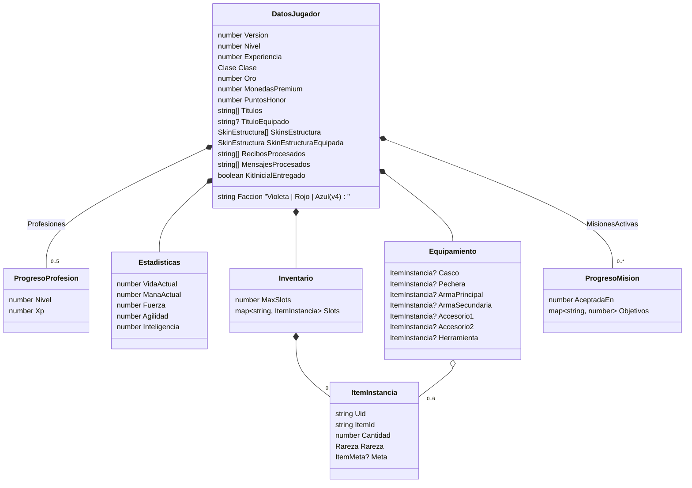
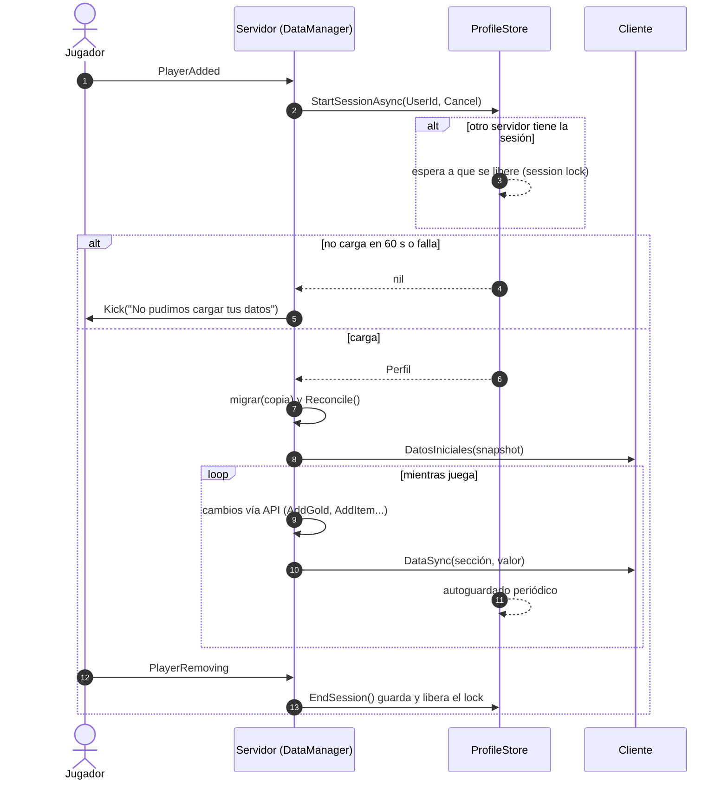
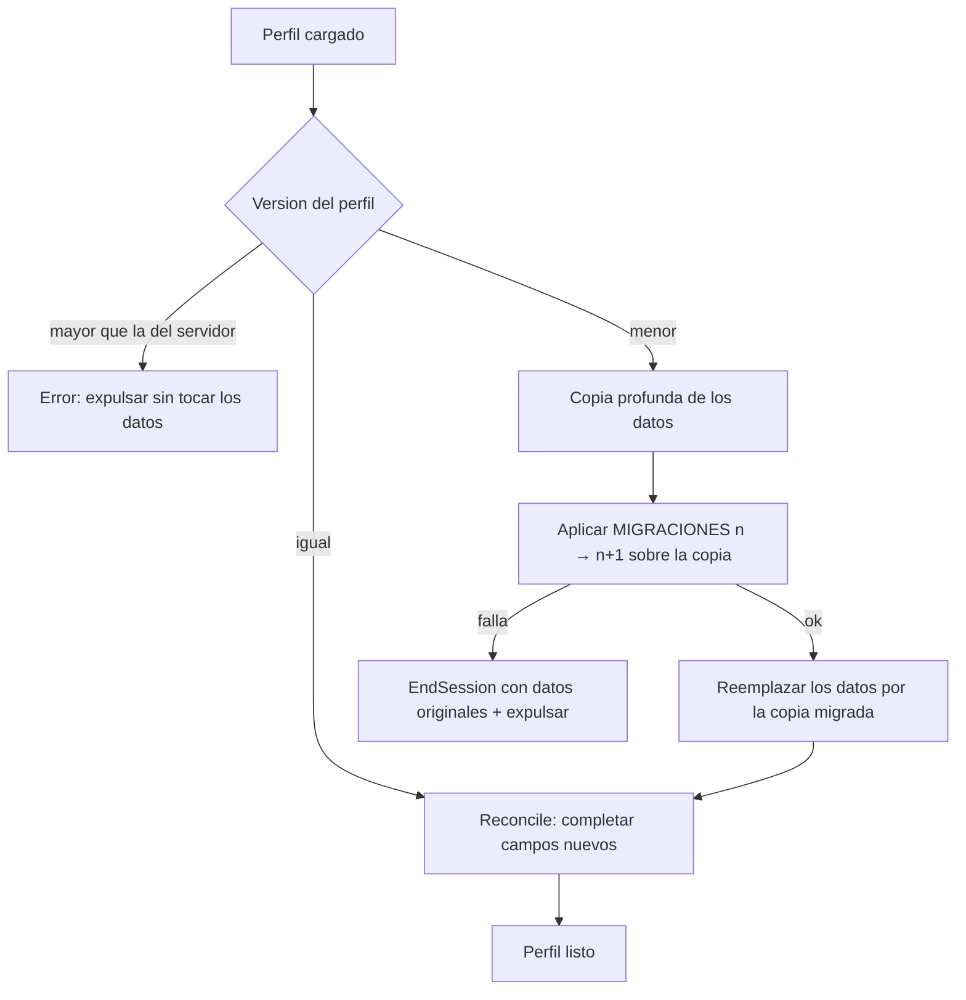
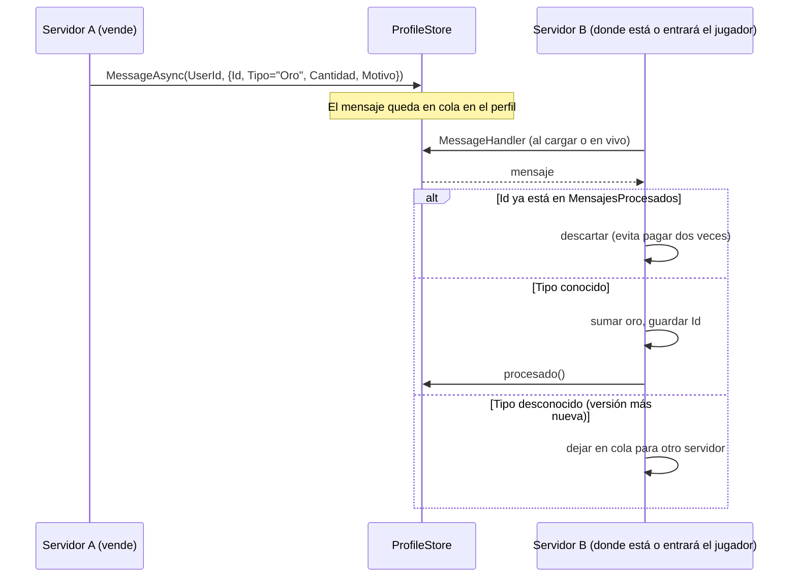

# Datos del jugador

`DataManager` es el único módulo que toca DataStores. Usa [ProfileStore](https://github.com/MadStudioRoblox/ProfileStore)
para tener **session locking**: un perfil solo puede estar abierto en un servidor a la vez, así nadie duplica ítems
entrando rápido a otro servidor.

## Esquema del perfil (versión 3)

Notas de diseño:

- **La rareza es de cada ítem**, no del jugador.
- **Las ranuras se indexan con texto** (`"1"`..`"MaxSlots"`): JSON corta un array en el primer `nil`, así que un
  inventario con huecos perdería ítems.
- **`MonedasPremium`** (comprada con Robux) solo la modifican la futura `MonetizationManager` y gastos validados
  por el servidor.
- `RecibosProcesados` y `MensajesProcesados` son listas acotadas (50 y 100) para la idempotencia de compras y del buzón.

## Ciclo de vida de una sesión

Reglas clave:

- **Si el perfil no carga, el jugador es expulsado.** Nunca juega con un perfil vacío, porque al guardar pisaría sus
  datos reales.
- Si otro servidor toma la sesión (`OnLastSave` con motivo `External`), este servidor expulsa al jugador con un
  mensaje claro.
- ProfileStore guarda todos los perfiles en `game:BindToClose` cuando el servidor se apaga.

## Migraciones de esquema

- Para agregar un campo nuevo con valor por defecto alcanza con sumarlo a `PLANTILLA`: `Reconcile` lo completa.
- Para **transformar** datos existentes, subí `GameConfig.Datos.VersionEsquema` y agregá `MIGRACIONES[n]`.
- Migraciones actuales: `[1]` (v1 → v2) agrega honor, títulos y skins de estructura; `[2]` (v2 → v3) agrega
  profesiones y el kit inicial.

## Buzón offline

Sirve para pagar a jugadores que no están conectados (por ejemplo, ventas de la Casa de Subastas). Usa
`ProfileStore:MessageAsync`, que funciona entre servidores.

## API del servidor

| Función | Devuelve | Notas |
| --- | --- | --- |
| `GetData(player)` | `DatosJugador?` | Solo lectura |
| `WaitForData(player, timeout?)` | `DatosJugador?` | Espera la carga |
| `SaveNowAsync(player, timeout?)` | `boolean` | Espera a que se escriba |
| `AddGold` / `SpendGold` | `boolean` | Todo o nada |
| `AddExperience(player, n)` | niveles ganados | Curva `100 · nivel^1.5` |
| `AddItem(player, id, n, rareza?, meta?)` | `boolean, CodigoError?` | Atómico: si no entra todo, no agrega nada |
| `RemoveItem` / `RemoveItemByUid` / `HasItem` / `CountItem` | — | `RemoveItem` gasta primero pilas sin metadatos |
| `SetMaxSlots` | `boolean` | No reduce por debajo de una ranura ocupada |
| `EnviarOroOffline(userId, n, motivo)` | `boolean` | Buzón entre servidores |
| `AddHonor`, `AddTitulo`, `UnlockSkinEstructura`, `SetSkinEstructura` | `boolean` | Fase 2 |
| `AddPremium`, `SpendPremium`, `ReciboYaProcesado`, `MarcarRecibo` | — | Solo para monetización |
| `SetClase`, `EquiparItem`, `DesequiparItem` | `boolean` | Fase 3 |
| `EnviarItemOffline(userId, itemId, n, rareza, meta, motivo)` | `boolean` | Buzón de ítems |
| `MoverRanura`, `DividirPila`, `QuitarDeRanura`, `AgregarInstancia`, `BuscarPorUid`, `RanurasLibres`, `RanurasNecesarias` | — | Fase 4: síncronas, todo o nada |
| `NivelProfesion`, `AddXpProfesion`, `MarcarKitInicial` | — | Profesiones |

Señales: `PerfilCargado(player, datos)` y `DatosCambiados(player, seccion)`.
