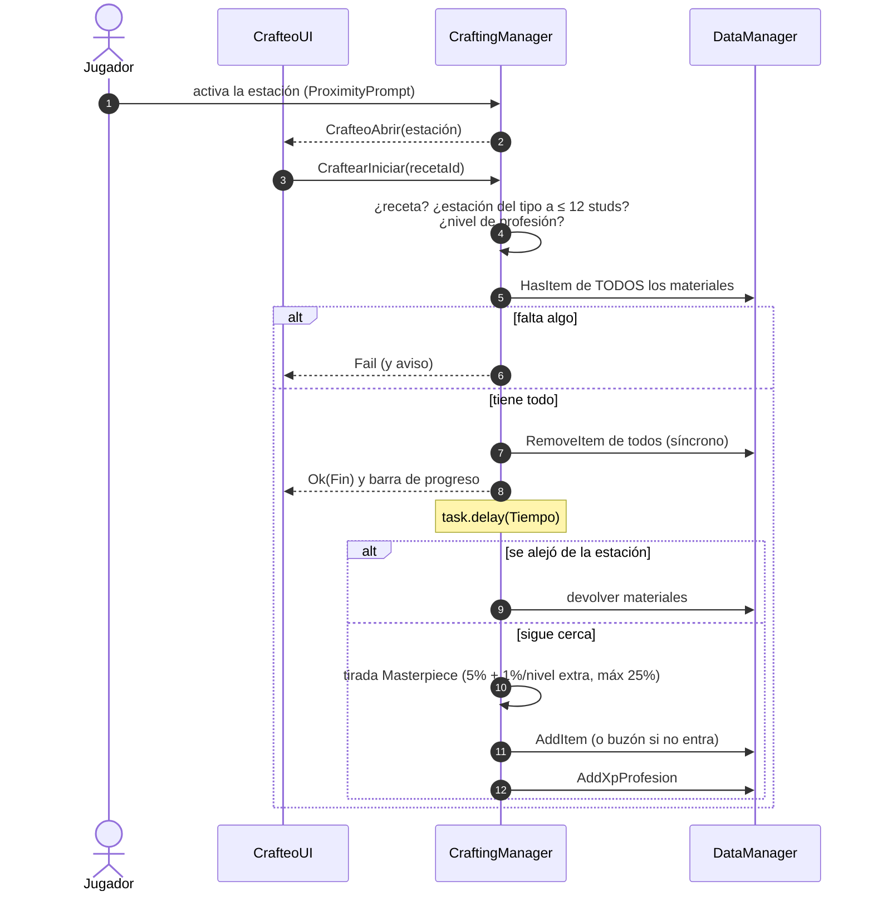
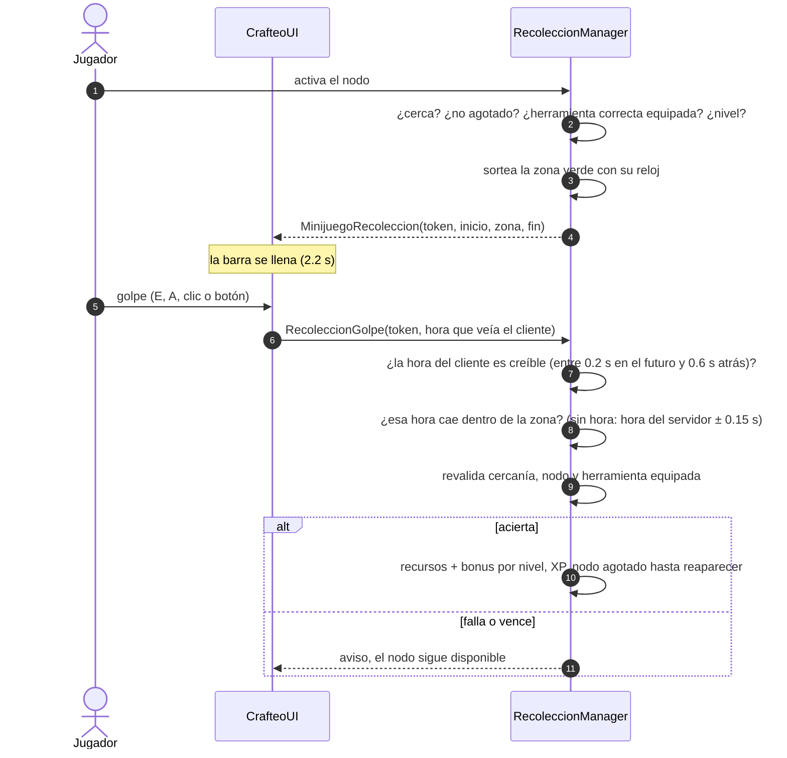
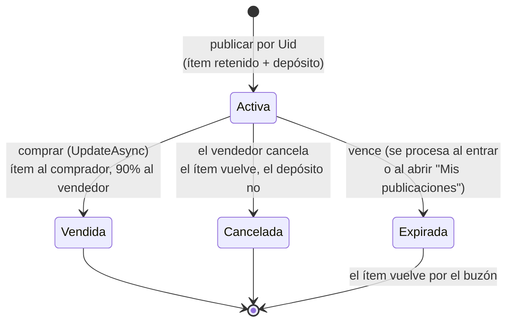
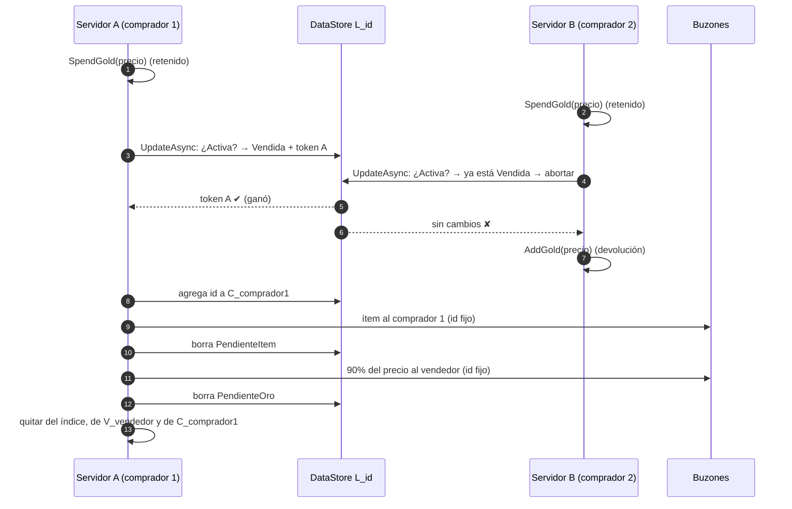
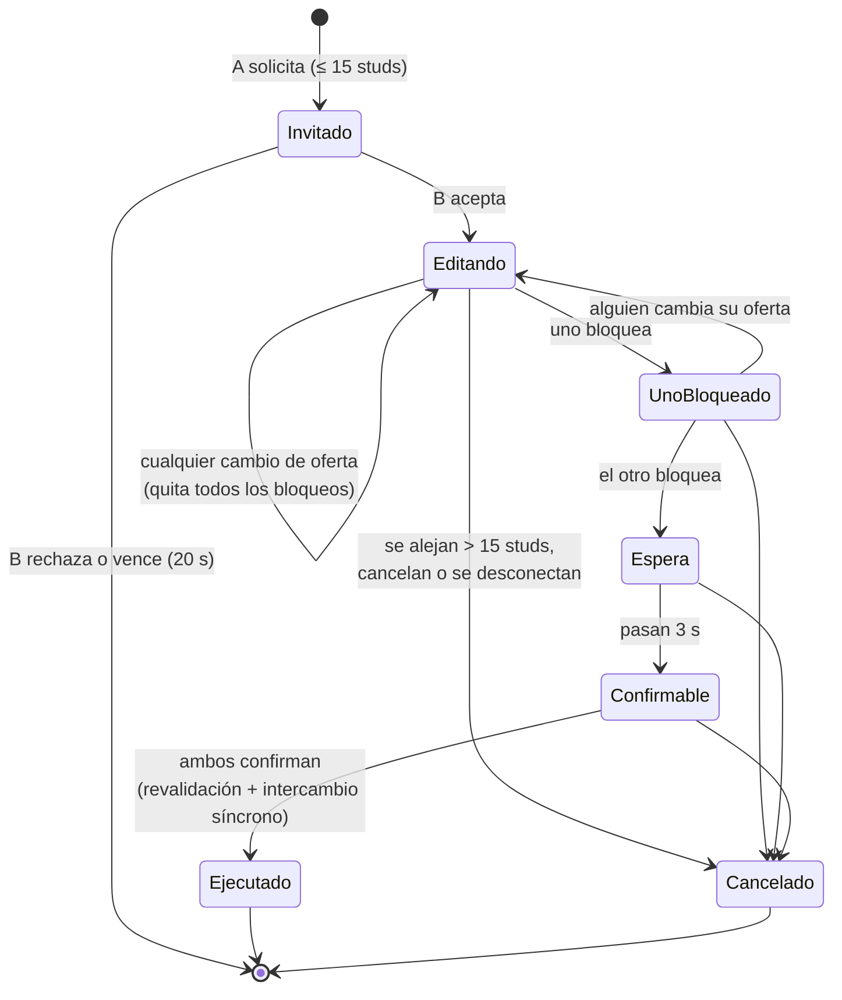

# Economía: inventario, profesiones, subastas y comercio

Todas las operaciones que mueven ítems u oro las decide el servidor y son **todo o nada**: o se aplican completas o
no se aplican. Las que tocan un solo servidor son síncronas (sin pausas entre validar y aplicar). Las que cruzan
servidores (subastas) usan `UpdateAsync` como árbitro y el buzón de ProfileStore para entregar.

## Módulos

| Módulo | Lado | Responsabilidad |
| --- | --- | --- |
| `DataManager` (sección de ranuras) | Servidor | Mover, combinar, dividir, quitar y agregar instancias; profesiones |
| `InventarioManager` | Servidor | Remotes de inventario, pociones, destruir, kit inicial |
| `CraftingManager` | Servidor | Estaciones, recetas, transacción atómica, Masterpiece |
| `RecoleccionManager` | Servidor | Nodos, herramienta requerida, minijuego validado |
| `AuctionManager` | Servidor | Casa de Subastas entre servidores |
| `TradeManager` | Servidor | Comercio directo 1v1 |
| `EstadoCliente` | Cliente | Espejo único de los datos del jugador para todas las interfaces |
| `UIKit` / `ItemInfo` | Cliente | Piezas de interfaz y descripción de ítems |
| `InventarioUI`, `CrafteoUI`, `SubastaUI`, `ComercioUI` | Cliente | Interfaces |

## Inventario

| Acción | Remote | Regla |
| --- | --- | --- |
| Mover / combinar / intercambiar | `MoverItem(desde, hacia)` | Destino vacío → mueve. Mismo ítem apilable sin metadatos → combina hasta el máximo. Otro caso → intercambia |
| Dividir | `DividirPila(desde, cantidad)` | Necesita una ranura libre |
| Usar | `UsarItem(ranura)` | Pociones: 35% de vida o maná, cooldown compartido de 10 s; se consume solo si tuvo efecto |
| Destruir | `DestruirItem(ranura)` | El cliente pide una segunda confirmación |
| Equipar / desequipar | `EquiparItem(uid)` / `DesequiparItem(slot)` | Recalcula las estadísticas de combate al instante |

**Controles de la mochila**

| | PC | Móvil | Consola |
| --- | --- | --- | --- |
| Abrir | I | Botón "Mochila" | Select |
| Mover | Arrastrar y soltar | Menú → "Mover…" → tocar destino | Menú (A) → "Mover…" → destino |
| Equipar | Arrastrar al slot o menú | Menú → "Equipar" | Menú → "Equipar" |
| Ver detalles | Pasar el mouse | Tocar | Seleccionar |

Los equipos y herramientas llevan sus metadatos en `Meta` (multiplicador, efectos, pasiva, Masterpiece). Los slots
de equipo son Casco, Pechera, Arma, Secundaria, Accesorio 1 y 2, y **Herramienta** (pico u hoz, sin stats de combate).

## Profesiones

| Profesión | Tipo | Estación / herramienta | Produce |
| --- | --- | --- | --- |
| Minería | Recolección | Pico | Mineral de hierro y de plata |
| Herboristería | Recolección | Hoz | Hierba sanadora, flor lunar, lino |
| Herrería | Producción | Yunque | Lingotes, pico, hoz, espada, casco, anillo |
| Alquimia | Producción | Mesa de Alquimia | Pociones de vida y maná |
| Sastrería | Producción | Telar | Tela de lino, túnica, capa de seda |

Niveles 1–50, XP para subir `50 × nivel^1.4`. Cada jugador nuevo recibe un pico y una hoz (kit inicial, una sola vez).

### Crafteo

**Masterpiece:** los equipos salen con `Meta.Mult = 1.1` (+10% de atributos) y `Masterpiece = true` (estrella y borde
dorado en la mochila); el resto de los productos da una unidad extra. Hay una ráfaga de partículas doradas en la estación.

### Recolección y minijuego

## Casa de Subastas

Compartida por todos los servidores de la experiencia.

La búsqueda filtra por **nombre, rareza, categoría** (Materiales, Consumibles, Equipo, Herramientas,
Cosméticos) y **precio máximo**; los filtros se aplican en el servidor. Se abre desde el tablón o hablando con el
Subastador ([NPCs](npcs.md)). Es de compra directa: no hay pujas.

| Almacenamiento | Clave | Uso |
| --- | --- | --- |
| DataStore (fuente de verdad) | `L_<id>` | Publicación: ítem, precio, vendedor, estado, vencimiento |
| DataStore | `V_<userId>` | Ids del vendedor: activas (límite de 5) o con entregas pendientes |
| DataStore | `C_<userId>` | Compras cuyo ítem todavía no se confirmó en el buzón del comprador |
| MemoryStore SortedMap | `<id>` | Índice de búsqueda ordenado por precio; vence junto con la publicación |

| Regla | Valor |
| --- | --- |
| Depósito al publicar (se quema) | 5% del precio, mínimo 1 |
| Impuesto al vender (se quema) | 10% del precio |
| Publicaciones simultáneas | 5 (15 con el pase de la Fase 6) |
| Duración | 48 h (30 min en Studio) |

En la pestaña **Vender**, cada objeto de la mochila tiene su propia casilla de precio (precio total de la pila), con
el depósito y lo que recibirías si se vende. "Publicar" publica esa fila; **"Publicar todo"** publica una tras otra
todas las filas con precio válido, y se frena si se llega al límite de publicaciones o falta oro para un depósito.

### Estados de una publicación

Cada transición se hace con `UpdateAsync` sobre `L_<id>`: el cambio solo se escribe si el estado actual lo permite, y
lleva un token único para que el servidor sepa si **su** llamada fue la que ganó (incluso si el `UpdateAsync` se
reintentó y un intento anterior ya se había escrito).

Publicar sigue este orden, pensado para que ninguna caída pierda ni duplique nada:

1. Se reserva el id en `V_<vendedor>` con `UpdateAsync` (el límite de 5 se comprueba ahí, de forma atómica).
2. Se busca el ítem por su **Uid** y se retienen el ítem y el depósito, sin pausas en el medio.
3. Se guarda el perfil (`SaveNowAsync`). Si falla, se devuelve todo.
4. Se crea `L_<id>` con `UpdateAsync` + token. Si no se sabe si se escribió, se verifica en segundo plano antes de
   devolver nada.
5. Se indexa en el MemoryStore.

Comprar también retiene el oro y guarda el perfil **antes** de la transición.

### Entregas pendientes

Al vender, cancelar o vencer, la publicación queda marcada con `PendienteItem` y/o `PendienteOro`. Cada marca se borra
recién cuando el buzón confirmó la entrega. Los mensajes usan ids fijos (`subasta:<id>:item`, `subasta:<id>:oro`), así
que reintentar nunca entrega dos veces. Si algo falla o el servidor se apaga, la entrega se reintenta cuando el
vendedor o el comprador vuelven a entrar, o al abrir "Mis publicaciones". La búsqueda lee hasta 1000 publicaciones
(5 páginas de 200) y las lecturas de `L_`, `V_` y `C_` no usan la caché del DataStore.

### Diario de operaciones (datos v5)

Guardar el perfil antes de escribir en la subasta no alcanza si el perfil no recuerda **qué** salió. Por eso, en el
mismo bloque sin pausas en que se retienen el ítem y el depósito (publicar) o el oro (comprar), se anota la operación
en `DatosJugador.Pendientes` (`Subastas[id]` o `Compras[id]`, con la hora). Ese diario se guarda junto con el resto.

- Si la operación se confirma, la entrada se borra.
- Si se sabe que no se hizo, se devuelve todo (directo al perfil, o por el buzón con id fijo) y se borra.
- Si no se sabe (el DataStore no respondió), **no se devuelve nada**: al volver a entrar, o 95 s después, se
  reconcilia contra `L_<id>`. Si la publicación existe, el ítem está ahí; si la compra figura a tu nombre, el ítem
  llega por `C_`; si no, se devuelve. Antes de 90 s no se da nada por perdido, porque la operación podría seguir en
  vuelo en otro servidor.

Las transiciones devuelven **tres** resultados: ganó, perdió o desconocido. Solo "perdió" permite devolver oro. Los ids
de los mensajes de subasta se recuerdan 30 días (`MensajesSubasta`), así un reintento tardío nunca entrega dos veces, y
`SaveNowAsync` solo confirma un guardado que incluye el último cambio (contador `SecuenciaGuardado`).

### Compra simultánea (dos jugadores, dos servidores)

El ítem comprado, el pago al vendedor y los ítems cancelados o vencidos viajan por el **buzón** (módulo `Buzon`:
ProfileStore `MessageAsync` con reintentos y el mismo Id en todos ellos). Llegan aunque el destinatario esté
desconectado o en otro servidor, y `DataManager` descarta los Ids ya procesados. Botín, crafteo y comercio usan el
mismo módulo, y el cierre del servidor espera hasta 25 s a que terminen los envíos en curso.

## Comercio 1v1

- **Nada sale del inventario hasta el final.** Al confirmar ambos se vuelve a validar todo (que los ítems y el oro
  sigan ahí y que haya espacio) y el intercambio se ejecuta sin pausas.
- Cada ítem ofrecido se guarda como "foto" (ítem, cantidad, rareza y metadatos). Si el inventario o el oro de alguien
  cambia y su oferta ya no coincide (por ejemplo, usó parte de una pila), el ítem sale de la oferta, el oro se ajusta y
  se quitan los bloqueos de ambos. Nadie puede confirmar viendo algo distinto de lo que se entrega.
- Hasta 8 ítems y oro por lado. Para empezar, activá "Comerciar" (tecla T o Y en el gamepad) sobre otro jugador.
- Cada comercio queda registrado en la consola del servidor (quién dio qué).

## Probar en Studio

Al darle Play se crean, cerca del spawn:

- **Estaciones** (70, −40): Yunque, Mesa de Alquimia y Telar.
- **Nodos de recolección** (100, −60): vetas de hierro y plata, hierbas, flor lunar y lino.
- **Casa de Subastas** (40, −30).

Pasos:

1. Abrí la mochila (I). Tenés un pico y una hoz: equipá el pico (arrastralo al slot Herramienta).
2. Andá a las vetas y recolectá: golpeá en la zona verde. Cambiá a la hoz para hierbas y lino.
3. En el Yunque fundí lingotes y fabricá; en la Mesa de Alquimia, pociones. Usá una poción desde la mochila.
4. Publicá algo en la Casa de Subastas y cancelalo desde "Mis publicaciones": vuelve por el buzón.
5. Con 2 jugadores (*Test > Clients and Servers*), comerciá: ofrecé, bloqueá, esperá 3 s y confirmá. Alejate durante
   el comercio para ver la cancelación.

La Casa de Subastas necesita *Enable Studio Access to API Services* (DataStore y MemoryStore). Para probar una compra
real hacen falta dos cuentas, porque no se puede comprar la publicación propia.
