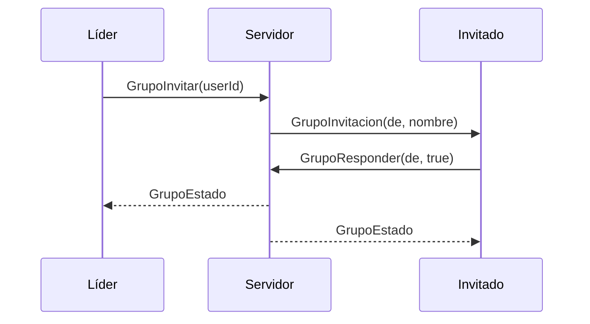

# Grupos (party)

Hasta **5 jugadores** (`GameConfig.Grupos.MaxMiembros`). El grupo vive solo en
el servidor (no se guarda): si salís del juego, salís del grupo.

## Cómo se usa

1. Botón **Grupo** (al lado de **Personaje**).
2. En "Jugadores en el servidor", **Invitar** a quien quieras.
3. El otro ve un aviso arriba con **Aceptar / Rechazar** (vence a los 30 s).
4. A la izquierda aparecen los marcos de tus compañeros con su vida.

El líder (👑) puede **Expulsar** y **Hacer líder** a otro. Cualquiera puede
**Salir**. Si el líder se va, el liderazgo pasa al siguiente; un grupo de una
sola persona se disuelve.

## Reglas del servidor

| Regla | Valor |
| --- | --- |
| Solo el líder invita | sí (o cualquiera si todavía no tiene grupo) |
| Espera entre invitaciones | 2 s |
| Vencimiento de la invitación | 30 s |
| Invitar a alguien que ya está en otro grupo | no |

## Para otros sistemas

`GrupoManager` expone `GrupoDe(player)`, `MiembrosDe(player)`,
`MismoGrupo(a, b)`, `Formar(lider, miembros)` y la señal `Cambio`. El jugador
lleva el atributo `GrupoId`. Lo van a usar el canal de voz de grupo y las
mazmorras.
