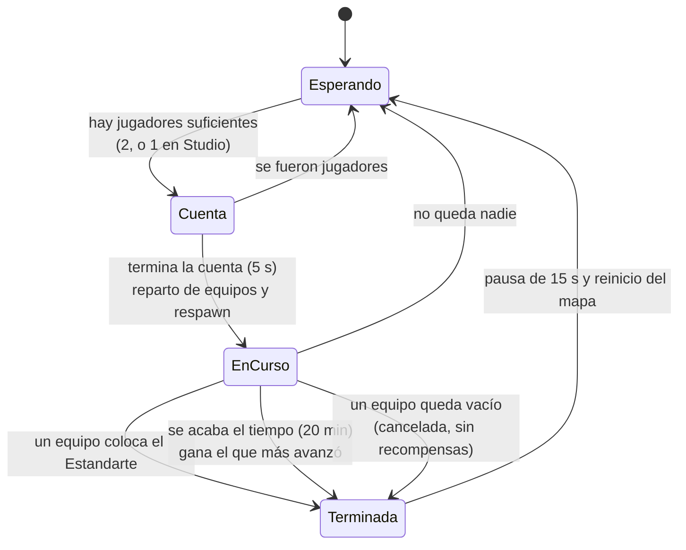
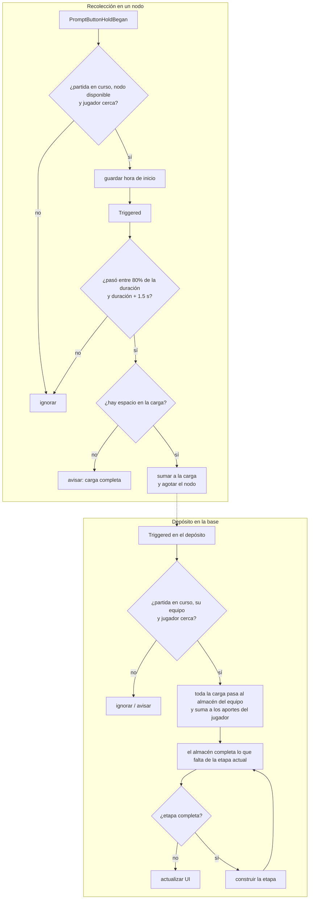

# Guerra de Arquitectos

Mapa pasivo **Team vs Team sin PvP directo**. Dos equipos (Reino Azul y Reino Rojo) recolectan recursos y construyen
su castillo en 5 etapas. Gana el primero que coloca el Estandarte.

## Ciclo de partida



## Etapas del castillo

| # | Etapa | Madera | Piedra | Hierro |
| --- | --- | --- | --- | --- |
| 1 | Fundación | 20 | 40 | — |
| 2 | Muros | 30 | 60 | — |
| 3 | Torres | 40 | 40 | 10 |
| 4 | Gran Salón | 60 | 30 | 20 |
| 5 | Estandarte | 10 | — | 20 |

En Studio los requisitos se dividen por 5 (`DivisorRequisitosEnStudio`) para poder jugar una partida completa en pocos minutos.

## Recursos

| Recurso | Por recolección | Mantener presionado | Reaparece |
| --- | --- | --- | --- |
| Madera (árboles) | 5 | 1.0 s | 8 s |
| Piedra (rocas) | 4 | 1.5 s | 10 s |
| Hierro (vetas) | 2 | 2.0 s | 15 s |

Cada jugador lleva hasta **30 unidades** en total.

## Recolección y depósito



**Almacén del equipo.** Todo lo depositado va al almacén, que completa sola la etapa actual y las siguientes. Así
ningún recurso es inútil (por ejemplo, el Hierro juntado temprano se usa en las Torres) y nadie queda trabado con la
carga llena de algo que todavía no se necesita. Un solo depósito puede completar varias etapas seguidas.

## Construcción de una etapa

1. Se sacan del espacio de las piezas a los jugadores que estén dentro y se los lleva al spawn de la base.
2. Se busca **quien más depositó** desde la etapa anterior y sigue en el equipo; se usa su skin de estructura equipada.
3. Las piezas pasan de holograma a sólido con el material y el color de esa skin, con una ráfaga de partículas y un sonido
   opcional (`GuerraConfig.SonidoEtapa`).
4. La bandera del Estandarte siempre usa el color del equipo.

| Skin | Material | Color |
| --- | --- | --- |
| Ninguna | Cobblestone | Piedra gris |
| Gótica | Slate | Gris muy oscuro |
| Hielo | Glacier | Celeste |
| Jade | Marble | Verde jade |

## Recompensas

| Resultado | Oro | Honor | Extra |
| --- | --- | --- | --- |
| Ganador | 500 | 100 | Título "Gran Arquitecto" |
| Perdedor o empate | 100 | 20 | — |
| Cancelada (equipo vacío) | — | — | — |

Solo cobra quien aportó **al menos 5 unidades** (evita quedarse AFK para cobrar). Los aportes se guardan por `UserId`:
si alguien sale y vuelve durante la partida, conserva lo aportado y vuelve a su equipo.

En Studio, con `DarRecompensasEnStudio = false`, la partida se juega sin tocar tu perfil.

## Mapa

Si el place tiene una carpeta `Workspace.GuerraArquitectos`, se usa esa. Si no, y se está probando en Studio,
`ArenaGuerra` genera una arena completa a unos 220 studs del origen (hacia +Z).

```text
Workspace.GuerraArquitectos
├── Base_Azul / Base_Rojo
│   ├── Centro     (Part anclada)   origen del castillo (40×40 studs)
│   ├── Deposito   (Part)           con ProximityPrompt "Depositar"
│   ├── Spawn      (SpawnLocation)  TeamColor del equipo, Neutral = false
│   └── Plano      (Folder, opcional) Parts con atributo Etapa = 1..5
└── Recursos       (Folder)         Parts con atributo Recurso = Madera | Piedra | Hierro
```

Si una base no trae `Plano`, el castillo se genera en código. A los prompts de los nodos siempre se les fija la
duración y la distancia que valida el servidor, aunque se hayan puesto a mano.

## Dónde corre el modo

`ArchitectWarManager.DebeActivarse()` devuelve verdadero si:

- el place es el de la Guerra (`ZoneConfig.Zonas.GuerraArquitectos.PlaceId`), o
- el Workspace tiene la carpeta `GuerraArquitectos`, o
- se está en Studio con `GuerraConfig.ProbarEnStudio = true`.
