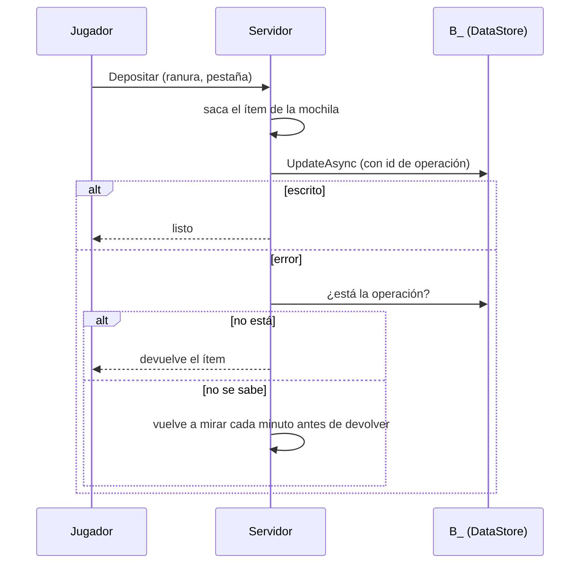

# Hermandades

Las hermandades (guilds) duran entre sesiones y entre servidores: si un
oficial te asciende desde otro servidor, lo ves en el tuyo.

## Cómo se usa

Botón **Hermandad** (al lado de **Grupo**).

- **Sin hermandad:** escribís un nombre y tocás **Fundar** (10.000 de oro,
  nivel 5 o más; en modo pruebas no se pide nivel). También podés esperar una
  invitación: aparece un aviso con **Unirme / Rechazar** (vence al minuto).
- **Miembros:** conectados primero, con su zona; los desconectados muestran
  hace cuánto se fueron. Según tu rango: ▲ / ▼ para cambiar rangos,
  **Expulsar**, **Hacer líder** (doble toque). Abajo, los jugadores del
  servidor sin hermandad, para **Invitar**.
- **Banco:** oro (depositar / retirar) y 4 pestañas de 28 lugares. A la
  derecha está tu mochila: **Depositar** manda la pila entera a la pestaña
  abierta. Tocar un ítem del banco lo retira (si tu rango puede).
- **Registro:** los últimos movimientos del banco y el historial de la
  hermandad (altas, bajas, rangos, liderazgo).
- **Rangos:** los permisos de cada rango. Solo el líder los cambia.

## Rangos y permisos

| Permiso | Líder | Oficial | Miembro | Recluta |
| --- | --- | --- | --- | --- |
| Invitar | sí | sí | sí | no |
| Expulsar | sí | sí | no | no |
| Cambiar rangos | sí | sí | no | no |
| Retirar ítems | sí | sí | no | no |
| Retirar oro | sí | sí | no | no |
| Depositar | sí | sí | sí | sí |

Esos son los valores iniciales (`GameConfig.Hermandades.PermisosIniciales`);
el líder los cambia en la pestaña **Rangos**. Además:

- Solo se puede expulsar o cambiar el rango de alguien de rango **menor** al
  tuyo, y solo a un rango menor al tuyo.
- Quien entra lo hace como **Recluta**.
- El líder no puede irse: primero pasa el liderazgo. Si queda solo, el botón
  pasa a **Disolver** (con el banco vacío).

## Cómo se guarda

| Clave (DataStore `Hermandades`) | Qué guarda |
| --- | --- |
| `G_<id>` | nombre, líder, miembros y rangos, permisos, historial |
| `B_<id>` | oro, 4 pestañas, registro de movimientos y últimas operaciones |
| `N_<nombre>` | reserva del nombre (no puede haber dos iguales) |
| `J_<userId>` | en qué hermandad está cada jugador |

Quién está conectado y en qué zona va en MemoryStore (vence solo si un
servidor se cae). Los cambios se avisan a los demás servidores por
MessagingService. En Studio todo usa stores aparte (`_Studio`).

### Sin duplicados (con diario en el perfil)

Cada operación del banco se anota en el perfil del jugador
(`Pendientes.Banco`) en el mismo instante en que sale el ítem o el oro, y el
perfil se guarda (`SaveNowAsync`) **antes** de tocar el banco. Así, aunque el
servidor se caiga en el medio, al volver a entrar se reconcilia contra `B_`:
lo depositado que no llegó vuelve, y lo retirado que sí salió se entrega.
La verificación lee `B_` sin caché y solo responde "no entró" si la lista de
operaciones del banco cubre todo el tiempo desde que se anotó.

Disolver cierra el banco (`Cerrado`) en la misma escritura que verifica que
esté vacío: después de eso no entra ningún depósito.

### Detalles anteriores

- Cada operación del banco lleva un id que queda guardado en `B_`. Si una
  escritura da error, se lee el banco: **solo** si la operación no está, se
  devuelve lo depositado (y si no se puede saber, se vuelve a mirar más tarde;
  la devolución va al buzón con id fijo, así no se repite).
- Retirar quita el ítem del banco y guarda la operación con el ítem; recién
  después se entrega. Para retirar, los permisos se leen sin caché.
- Para entrar a una hermandad primero se anota `J_` y después `G_`; para salir,
  al revés. Si algo se corta en el medio, al reconectarse se corrige solo.

## Para otros sistemas

`HermandadManager.HermandadDe(player)` y `MismaHermandad(a, b)`; el jugador
lleva los atributos `HermandadId` y `Hermandad` (nombre). Lo va a usar el canal
de voz de hermandad.
