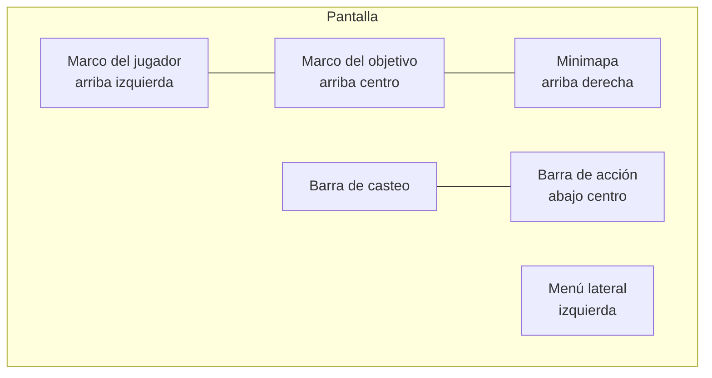

# Interfaz y administración (Fase 7)

## HUD (`CombatClient`, `Modules/Hud.luau`)

- **Marco del jugador:** retrato del avatar (borde del color del bando),
  nivel, clase, vida (verde), maná (azul) y experiencia (púrpura).
- **Marco del objetivo:** nombre, nivel y vida (rojo enemigo, verde aliado,
  amarillo neutral: un Violeta de por medio). Debajo, hasta 4 **buffs y
  debuffs** con cuenta regresiva (Aturdido, Provocado, Invisible, +X% de un
  stat, Regeneración, Quemadura, Sangrado). El servidor los publica en el
  atributo `Efectos` del modelo (`Nombre|Hasta|B/D;...`), solo cuando cambian.
- **Barra de acción (8 ranuras):** habilidades 1–4, parry (F), poción de vida
  (5), poción de maná (6) y montura (G). Cada una con su tecla, el costo de
  maná o la cantidad de pociones y un **barrido circular** de recarga (dos
  mitades con UIGradient, sin imágenes). En gamepad: pociones con la cruceta
  izquierda/derecha.
- **Escala:** todo el HUD está diseñado en píxeles para 1280×720 y lleva un
  `UIScale` = tamaño de pantalla × ajuste del jugador.

## Ajustes de interfaz (panel Personaje)

| Ajuste | Opciones | Campo del perfil |
|---|---|---|
| Mano | Diestro / **Zurdo** | `Ajustes.Zurdo` |
| Tamaño | Chico 0,85 · Normal · Grande 1,15 · Enorme 1,3 | `Ajustes.EscalaUI` (0,75–1,3) |
| Números de daño y cura | Mostrar / Ocultar | `Ajustes.TextosCombate` |
| Minimapa | Mostrar / Ocultar | `Ajustes.Minimapa` |

**Zurdo** espeja el HUD: el menú lateral pasa al borde derecho, el minimapa a
la izquierda y el marco del jugador a la derecha. En pantallas táctiles la
barra de acción es un bloque de 4×2 del lado de la mano hábil (derecha, o
izquierda con Zurdo). Son campos opcionales: no cambia la versión de datos.

## Números flotantes (`CombatEffectsClient`)

Físico blanco, mágico azul/púrpura, crítico dorado con rebote, cura verde con
"+", estados naranjas y "¡FALLO!" / "¡ESQUIVADO!" en gris (ver esquiva y fallo
en [combate](combate.md)). Todo en el cliente; se apagan con el ajuste.

## Minimapa (`MinimapaUI`, `Modules/Radar.luau`)

**Radar 2D por coordenadas**, no ViewportFrame: un ViewportFrame tendría que
clonar el mapa y dibujarlo en 3D una segunda vez; el radar solo mueve puntos de
interfaz y con muchos jugadores cuesta casi lo mismo.

- Arriba a la derecha (izquierda con Zurdo), con **marco metálico** y remaches.
  El disco es un `CanvasGroup` con `UICorner` al máximo: es lo que de verdad
  recorta en círculo (`ClipsDescendants` solo no recorta esquinas redondeadas).
- **Gira con la cámara**; la flecha del centro es tu personaje. Debajo: zona
  (atributo `Zona` de Workspace), coordenadas X/Z y servidor.
- Se dibuja en cada frame (`RenderStepped`). Buscar entidades es lo caro, así
  que `Radar` rehace la lista cada 0,5 s y por frame solo se leen posiciones.
- Zoom con + y − (radios de 60, 120, 240 y 480 studs). El botón M abre el mapa.

| Punto | Qué es | De dónde sale |
|---|---|---|
| ● azul con borde | Tu grupo (pegado al borde si está lejos) | Jugadores con tu mismo atributo `GrupoId` |
| ● rojo | Enemigos | Modelos de `Workspace.Enemigos` con Humanoid vivo |
| ◆ rojo grande | Élites y jefes | Lo mismo, con el atributo `Elite = true` |
| ! amarillo / ? gris | NPC de misión | Tag `NpcMision` (el signo lo pone `MisionesUI`) |
| ■ amarillo | Recursos (vetas y plantas) | Tag `NodoRecoleccion` |
| ✦ amarillo | Restos del Spoil del Chatarrero | Tag `RestosSpoil` |
| ◈ violeta | Portales | Tag `Portal` |
| · gris | Estaciones y Casa de Subastas | Tags `EstacionCrafteo`, `CasaSubastas` |

Para que algo aparezca en los mapas alcanza con respetar esa carpeta, esos
tags (CollectionService) y esos atributos. Toda la interfaz se crea por código
dentro de `PlayerGui`: no hay que armar nada en `StarterGui`.

## Mapa del mundo (`MapaMundoUI`)

- **M** (R1 en gamepad) o el botón M del minimapa lo abren y lo cierran; el
  botón **X** de arriba a la derecha lo cierra. Empieza cerrado.
- `ScreenGui "MapaMundoUI"` (`ResetOnSpawn = false`, `DisplayOrder = 50`) →
  `Frame "MarcoMapa"` (pergamino con borde de metal, 70% × 70%, centrado) →
  `TextLabel "Titulo"`, `TextButton "BotonCerrar"`, `ImageLabel "Lienzo"`
  (el mapa, siempre cuadrado) con `TextLabel "Pin"`, y `TextLabel "Pie"`.
- El pin muestra tu posición y hacia dónde mirás en tiempo real. También se
  ven portales, NPCs de misión, estaciones, élites, restos y tu grupo.
- **Cuenta mundo → mapa** (`aMapa`), con el norte (−Z) arriba:
  `u = (x − Centro.X) / Tamano + 0,5` y `v = (z − Centro.Z) / Tamano + 0,5`.
  `u` y `v` van de 0 a 1 y son la posición en escala dentro del Lienzo.
- `ZoneConfig.Mapas[zona] = { Centro, Tamano, Imagen }` define el cuadrado del
  mundo que entra en el mapa. `Imagen` es opcional (`rbxassetid://...` de una
  vista cenital cuadrada); sin imagen se dibuja un pergamino con cuadrícula.
  Hoy solo está cargada la zona de pruebas: sumá una entrada por zona real.
- El seguimiento de misiones y el panel de mazmorra están en y = 0,37 para no
  tapar el minimapa.

## Panel de administración (`AdminManager`, `AdminUI`)

- **Quién es admin** lo decide solo el servidor: el creador (o el dueño del
  grupo dueño del juego), `ConfigServidor.Admins` y, en Studio, quien prueba.
  El atributo `Admin` solo muestra el botón "🛡 Admin"; cada acción se vuelve
  a validar, con límite de 5 acciones cada 2 s.
- **Moderación:** ir hacia un jugador, traerlo (con gracia del anti-cheat),
  expulsar con motivo, **banear para siempre** y desbanear por UserId. El
  baneo usa `Players:BanAsync` (todo el juego, incluye cuentas alternativas) y
  además queda en el DataStore `Baneos` (`Baneos_Studio` en Studio), que se
  revisa al entrar. No se puede banear ni expulsar a otro admin.
- **Diseño de juego:** dar oro, dar ítem por id (cantidad o rareza fija),
  ver inventario y equipo, revivir, e invocar un RaidBlox de prueba 30 studs
  adelante (no reaparece al morir; falla si ya está vivo).
- **Registro:** cada acción se escribe en la consola del servidor y, si
  `ConfigServidor.WebhookAdmin` tiene una URL, se manda a Discord (cola de 50,
  una cada 2 s, sin menciones).

### Webhook de Discord

Discord bloquea los pedidos que salen de Roblox, así que hace falta un
**proxy de webhooks**: creá el webhook en tu canal privado (Configuración del
canal → Integraciones → Webhooks), tomá su URL y cambiá el dominio
`discord.com` por el del proxy que uses. Pegala en
`ConfigServidor.WebhookAdmin` (vive en el servidor: los clientes no la ven) y
activá **Permitir solicitudes HTTP** en Configuración del juego → Seguridad.

## Avisos y Guerra (estilo HUD)

- **Avisos** (`Modules/Avisos.luau`): pastillas con franja e ícono del color
  del tipo (Info, Error, Oro, Zona, Guerra), debajo del centro de la pantalla.
  Máximo 4 a la vez; un mensaje repetido se junta en uno con "×N". Escalan con
  el HUD.
- **Barras de RaidBlox:** debajo del marco del objetivo.
- **Guerra de Arquitectos** (`GuerraUI`): panel debajo del minimapa (mismo
  lado) con la fase y el reloj (rojo en el último minuto) y una tarjeta por
  reino: etapa, barra, lo que falta de cada recurso (🪵 🪨 ⛓) y el almacén.
  Tu reino lleva borde dorado. Lo que cargás va en una pastilla arriba de la
  barra de acción (naranja si está lleno).
