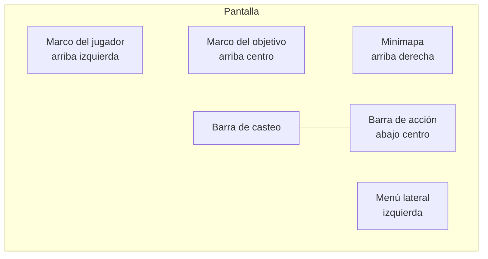

# Interfaz y administración (Fase 7)

## HUD (`CombatClient`, `Modules/Hud.luau`)

- **Marco del jugador:** retrato del avatar (borde del color del bando),
  nivel, clase, vida (verde), maná (azul) y experiencia (púrpura).
- **Marco del objetivo:** nombre, nivel y vida (rojo enemigo, verde aliado,
  amarillo neutral: un Violeta de por medio). Debajo, hasta 4 **buffs y
  debuffs** con cuenta regresiva (Aturdido, Provocado, Invisible, +X% de un
  stat, Regeneración, Quemadura, Sangrado). El servidor los publica en el
  atributo `Efectos` del modelo (`Nombre|Hasta|B/D;...`), solo cuando cambian.
- **Barra de acción (8 ranuras):** habilidades 1–4, parry (F), poción de vida
  (5), poción de maná (6) y montura (G). Cada una con su tecla, el costo de
  maná o la cantidad de pociones y un **barrido circular** de recarga (dos
  mitades con UIGradient, sin imágenes). En gamepad: pociones con la cruceta
  izquierda/derecha.
- **Escala:** todo el HUD está diseñado en píxeles para 1280×720 y lleva un
  `UIScale` = tamaño de pantalla × ajuste del jugador.

## Ajustes de interfaz (panel Personaje)

| Ajuste | Opciones | Campo del perfil |
|---|---|---|
| Mano | Diestro / **Zurdo** | `Ajustes.Zurdo` |
| Tamaño | Chico 0,85 · Normal · Grande 1,15 · Enorme 1,3 | `Ajustes.EscalaUI` (0,75–1,3) |
| Números de daño y cura | Mostrar / Ocultar | `Ajustes.TextosCombate` |
| Minimapa | Mostrar / Ocultar | `Ajustes.Minimapa` |

**Zurdo** espeja el HUD: el menú lateral pasa al borde derecho, el minimapa a
la izquierda y el marco del jugador a la derecha. En pantallas táctiles la
barra de acción es un bloque de 4×2 del lado de la mano hábil (derecha, o
izquierda con Zurdo). Son campos opcionales: no cambia la versión de datos.

## Números flotantes (`CombatEffectsClient`)

Físico blanco, mágico azul/púrpura, crítico dorado con rebote, cura verde con
"+", estados naranjas y "¡FALLO!" / "¡ESQUIVADO!" en gris (ver esquiva y fallo
en [combate](combate.md)). Todo en el cliente; se apagan con el ajuste.

## Minimapa (`MinimapaUI`)

- Círculo arriba a la derecha que **gira con la cámara**; la flecha es tu
  personaje. Debajo: zona (atributo `Zona` de Workspace), coordenadas X/Z y
  servidor.
- Marcadores: grupo (azul, fijos en el borde si están lejos), enemigos (rojo,
  hasta 40), NPCs de misión (! amarillo / ? gris, lo marca `MisionesUI`),
  vetas y plantas (verde), portales (violeta).
- Zoom con + y − (radios de 60, 120, 240 y 480 studs). **M** (o R1 en
  gamepad, o el botón M) abre el mapa del mundo con el norte arriba.
- El seguimiento de misiones y el panel de mazmorra bajaron a y = 0,37 para no
  tapar el minimapa.

## Panel de administración (`AdminManager`, `AdminUI`)

- **Quién es admin** lo decide solo el servidor: el creador (o el dueño del
  grupo dueño del juego), `ConfigServidor.Admins` y, en Studio, quien prueba.
  El atributo `Admin` solo muestra el botón "🛡 Admin"; cada acción se vuelve
  a validar, con límite de 5 acciones cada 2 s.
- **Moderación:** ir hacia un jugador, traerlo (con gracia del anti-cheat),
  expulsar con motivo, **banear para siempre** y desbanear por UserId. El
  baneo usa `Players:BanAsync` (todo el juego, incluye cuentas alternativas) y
  además queda en el DataStore `Baneos` (`Baneos_Studio` en Studio), que se
  revisa al entrar. No se puede banear ni expulsar a otro admin.
- **Diseño de juego:** dar oro, dar ítem por id (cantidad o rareza fija),
  ver inventario y equipo, revivir, e invocar un RaidBlox de prueba 30 studs
  adelante (no reaparece al morir; falla si ya está vivo).
- **Registro:** cada acción se escribe en la consola del servidor y, si
  `ConfigServidor.WebhookAdmin` tiene una URL, se manda a Discord (cola de 50,
  una cada 2 s, sin menciones).

### Webhook de Discord

Discord bloquea los pedidos que salen de Roblox, así que hace falta un
**proxy de webhooks**: creá el webhook en tu canal privado (Configuración del
canal → Integraciones → Webhooks), tomá su URL y cambiá el dominio
`discord.com` por el del proxy que uses. Pegala en
`ConfigServidor.WebhookAdmin` (vive en el servidor: los clientes no la ven) y
activá **Permitir solicitudes HTTP** en Configuración del juego → Seguridad.
