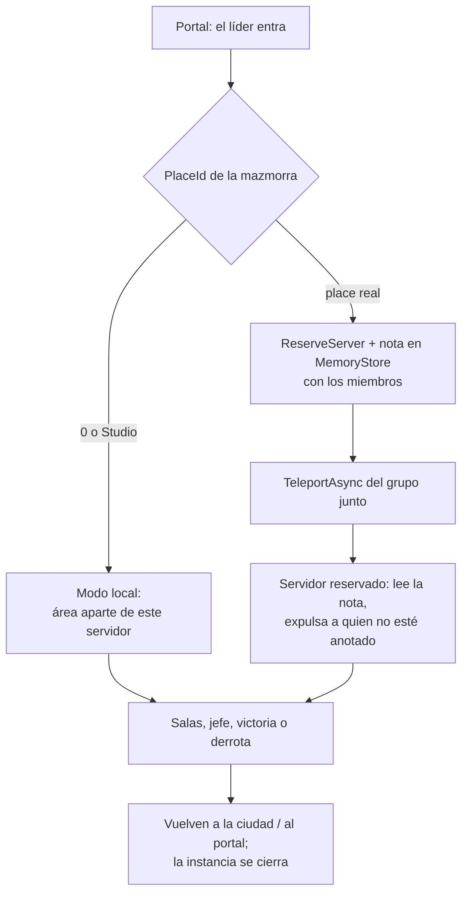

# Mazmorras

Instancias privadas para un grupo de hasta 5. La primera es la **Cripta del
Guardián** (`MazmorrasConfig`).

## Cómo se entra

En la zona de pruebas (y en la Ciudad Principal) hay un **portal violeta**. El
**líder del grupo** (o alguien que juega solo) lo activa y entran juntos todos
los del grupo que estén a menos de 60 studs del portal. No pueden estar en otra
mazmorra ni en la Guerra, y necesitan el nivel mínimo (en modo pruebas no se
pide).

## Adentro

1. **Salas** con enemigos: la puerta del fondo se abre cuando no queda ninguno.
2. **Sala del jefe**, el Guardián de la Cripta (su vida crece con el tamaño del grupo):
   - **Golpe Sísmico**: zona roja alrededor suyo; salí antes del golpe.
   - **Derrumbe**: zona roja sobre un jugador al azar.
   - **Llamado de la Manada**: invoca lobos al 66% y al 33% de vida.
3. **Victoria** al matar al jefe: botín personal de cada enemigo, más 100 de oro
   y 300 de experiencia para cada uno. Aparece un portal de salida y a los 45 s
   vuelven todos solos.

**Derrota**: si el grupo muere entero, los enemigos se recuperan y el grupo
reaparece en la entrada de la sala. Hay **3 intentos** y **20 minutos**; si se
acaban, la mazmorra los expulsa. Arriba a la derecha está el panel con la sala,
los enemigos que quedan, el tiempo, los intentos, la vida del jefe y **Salir**.

## Dos modos

- **Modo local** (`PlaceId = 0`, como ahora, o en Studio): la instancia se arma
  lejos, en el aire, dentro del mismo servidor. Sirve para probar ya.
- **Modo reservado**: al crear un place para la mazmorra, poné su `PlaceId` en
  `MazmorrasConfig`. El servidor reserva un servidor privado, anota en
  MemoryStore quiénes van (el TeleportData no se usa porque lo puede tocar el
  cliente) y los lleva juntos. Al terminar los devuelve al place de origen, y el
  servidor reservado se cierra solo al quedar vacío.
