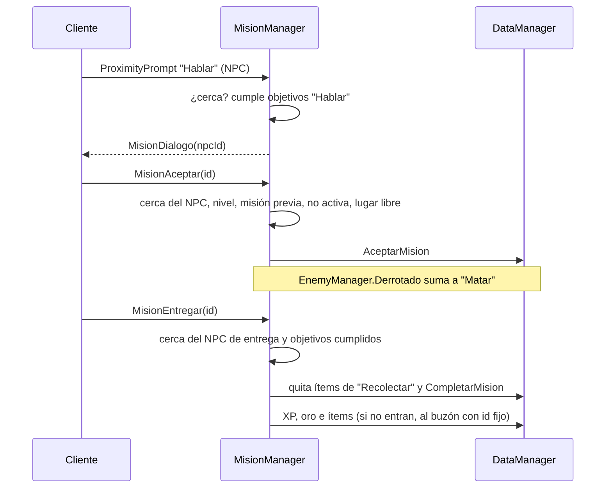
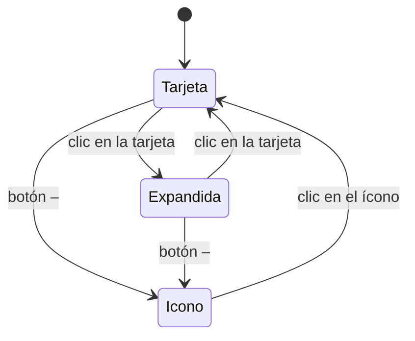

# Misiones (Fase 5.2)

Las misiones y los NPCs que las dan están en `Configs/MisionesConfig` (compartido: el servidor aplica las reglas y el
cliente lo usa para diálogos, marcadores y seguimiento). En el perfil viven en `MisionesActivas` (con el progreso de
cada objetivo) y `MisionesCompletadas` (con la fecha).

| Objetivo | Cómo avanza |
|---|---|
| **Matar** | Cuando muere el enemigo (`EnemyManager.Derrotado`), para **todos los que participaron** en la pelea. El id es el de `EnemigosConfig.Enemigos` o `RaidBloxConfig.Jefes`. |
| **Recolectar** | Se cuenta lo que tenés en la mochila; al entregar, esos ítems se quitan (todo o nada). |
| **Hablar** | Se cumple al hablarle al NPC indicado. |

**Marcadores** (solo los ve cada jugador): `!` amarillo = misión disponible, `?` gris = en curso, `?` amarillo = lista
para entregar. El **seguimiento** a la derecha muestra hasta 5 misiones activas, cada una como una tarjeta con tres estados:

- **Tarjeta:** nombre y progreso de cada objetivo.
- **Expandida:** suma la descripción, la recompensa, a quién se entrega y si se puede repetir.
- **Ícono:** un cuadrado chico (📜, o ✔ amarillo si está lista para entregar).

El estado es por misión y dura la sesión; no se guarda en el perfil.

**NPCs de prueba** (con `ModoPruebas` o en Studio): el **Capitán Aldric** cerca del spawn, **Brom** el herrero junto a
las estaciones y **Mira** la herbolaria junto a los nodos de recolección. En los mapas reales, cualquier modelo con la
etiqueta `NpcMision` y el atributo `NpcId` funciona como NPC de misiones.

Misiones de ejemplo: Bienvenida (hablar con Brom) → Lobos al acecho → Bandidos del camino → El Gólem de Obsidiana;
Práctica de combate (repetible); Hierbas curativas; Mineral para la forja.
