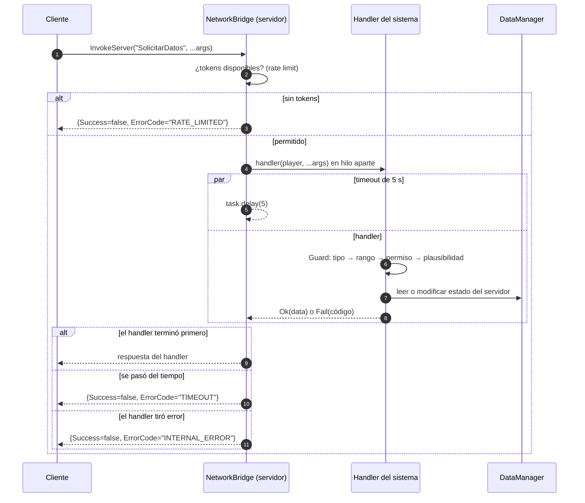
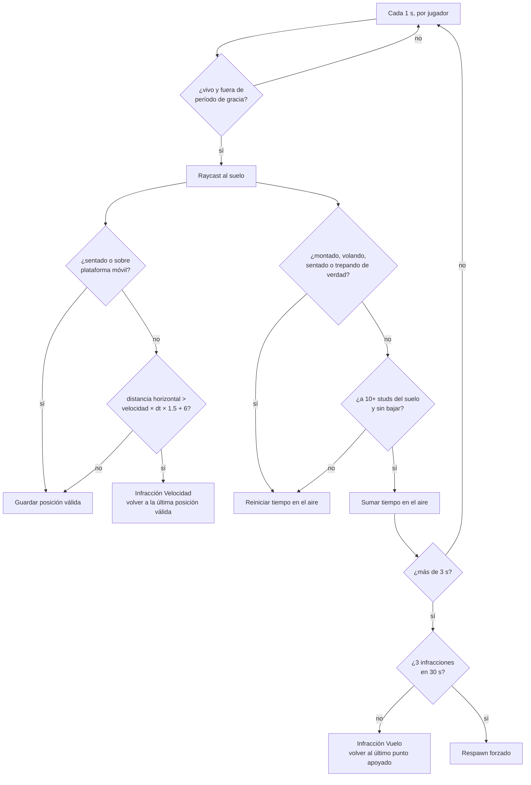

# Red y seguridad

Cualquier cliente de Roblox puede ser modificado por su usuario: puede disparar cualquier remote con cualquier
argumento, leer todo el código del cliente y mover su personaje como quiera. La seguridad existe **solo en el servidor**.

## NetworkBridge

Es la única puerta de red del juego.

- **El servidor crea todos los remotes** a partir de la tabla `DEFINICIONES`. Los remotes que estén en Studio de antes se borran.
- **Rate limiting por jugador y por remote** con token bucket: 10 peticiones por segundo en canales críticos
  (ataques, uso de ítems) y 5 por segundo en los normales.
- **RemoteFunctions con timeout de 5 s**: siempre responden `{ Success, ErrorCode, Data }`.
- Los remotes que solo van de servidor a cliente tienen un listener vacío en el servidor, para que los `FireServer`
  de un exploit no se acumulen en cola.

### Recorrido de una petición

### Validadores (`NetworkBridge.Guard`)

| Función | Rechaza |
| --- | --- |
| `Number(v, min, max)` | No números, `NaN`, `±inf`, fuera de rango |
| `Integer(v, min, max)` | Lo anterior y decimales |
| `String(v, maxLargo)` | No strings, vacíos, demasiado largos |
| `Boolean(v)` | No booleanos |
| `OneOf(v, tabla)` | Claves que no existen (ej. ids de catálogo) |
| `InstanceOf(v, clase)` | Otra clase o instancias fuera del juego |

Orden de validación en cada handler: **tipo → rango → permiso → plausibilidad**. Si algo falla, la petición se descarta
en silencio (sin darle información al exploiter).

### Códigos de error

`TIMEOUT`, `RATE_LIMITED`, `INVALID_ARGS`, `NOT_FOUND`, `NOT_ALLOWED`, `INSUFFICIENT_FUNDS`, `INVENTORY_FULL`,
`DATA_NOT_LOADED`, `INTERNAL_ERROR`.

## Anti-cheat de movimiento

El cliente simula su propio personaje, así que el speedhack y el vuelo no se pueden impedir del todo: se detectan y se
corrigen. Todo se decide con lo que **el servidor observa** (posiciones muestreadas y raycasts). La velocidad,
`FloorMaterial` y el estado del Humanoid los reporta el cliente, así que no se usan para decidir.

- **Nunca se banea automáticamente.** El lag de los móviles también genera picos; solo se registra y se corrige.
- Otros sistemas avisan cuando mueven al jugador a propósito: `AntiCheat.Gracia(player, segundos)` para teleports y
  empujones, y `AntiCheat.SetVelocidadPermitida(player, n)` para monturas y buffs.
- Los atributos `Montado` y `Volando` los pone el servidor. Si el cliente los cambia, el cambio no se replica, así que no los puede falsear.
- No hay chequeo de atravesar paredes con rayos: da falsos positivos al doblar esquinas. Igual no aporta ventaja,
  porque toda acción valiosa valida la distancia en el servidor.
- La señal `AntiCheat.Infraccion(player, tipo, detalle)` queda disponible para logs.

## Superficies de ataque cubiertas

| Ataque | Mitigación |
| --- | --- |
| Disparar remotes en masa | Token bucket por jugador y remote |
| Argumentos `NaN` / `inf` / tipos raros | `Guard` en cada handler |
| Duplicar ítems saltando de servidor | Session locking (ProfileStore) |
| Jugar con un perfil vacío y pisar el real | Expulsar si no carga |
| Pagos duplicados del buzón | `Id` por mensaje + `MensajesProcesados` |
| Hilos colgados por RemoteFunctions | Timeout de 5 s y nunca `InvokeClient` |
| Tocar portales o prompts a distancia | Distancia validada en el servidor |
| Saltear el tiempo de mantener presionado | Inicio y duración verificados en el servidor |
| Teletransportarse a una zona de mayor nivel | Nivel validado también al llegar |
| Speedhack / vuelo | AntiCheat (rubberbanding y respawn) |
| Cobrar una compra dos veces o no entregarla | `ProcessReceipt` idempotente: `PurchaseGranted` solo tras guardar |
| Duplicar con subastas o el banco de hermandad | Diario en el perfil + reconciliación al entrar |
| Usar el panel de admin sin serlo | Permiso decidido solo en el servidor y revalidado en cada acción |
| Saltear una recarga larga muriendo o reconectando | Recargas de 60 s o más guardadas en el perfil |
| Usar una ulti y cambiarla por otra lista | No se puede mover de barra una habilidad en recarga |
| Farmear materiales con muñecos de práctica | El Spoil no funciona en muñecos |
| Leer el webhook o la lista de admins | Viven en `ConfigServidor` (ServerScriptService): no se replican |
