# Roadmap

## Fases

```mermaid
flowchart LR
    F1[Fase 1<br/>Datos, red, anti-cheat]:::hecho --> F2[Fase 2<br/>Zonas, Guerra de Arquitectos]:::hecho
    F2 --> F3[Fase 3<br/>Combate, 8 clases,<br/>RaidBlox, rarezas]:::hecho
    F3 --> F4[Fase 4<br/>Inventario, crafteo,<br/>subastas, comercio]:::hecho
    F4 --> F5[Fase 5<br/>Voz, misiones,<br/>hermandades, dungeons]:::hecho
    F5 --> F6[Fase 6<br/>Monetización<br/>y cosméticos]:::hecho
    F6 --> F7[Fase 7<br/>HUD, combat text,<br/>minimapa, admin]:::hecho
    F7 --> L[Lanzamiento<br/>mapas reales,<br/>pruebas, Ids]:::siguiente

    classDef hecho fill:#2e7d32,color:#fff,stroke:#1b5e20
    classDef siguiente fill:#f9a825,color:#000,stroke:#f57f17
```

| Fase | Sistemas | Estado |
| --- | --- | --- |
| 1 | DataManager (ProfileStore), NetworkBridge, AntiCheat | ✅ |
| 2 | ZoneManager, pantalla de carga, Guerra de Arquitectos | ✅ |
| 3 | CombatManager (FSM, tab-targeting, parry), 8 clases, EnemyManager, RaidBloxManager, rarezas, botín | ✅ |
| 4 | Inventario drag & drop, profesiones (crafteo y recolección), AuctionManager, comercio 1v1 | ✅ |
| 5 | VozManager, misiones, grupos, hermandades, mazmorras | ✅ |
| 6 | Pases, productos y cajas, pase de batalla, transmog, mascotas, códigos | ✅ |
| 7 | HUD, target frame con buffs, combat text, ajustes y zurdos, minimapa, panel de admin | ✅ |

El detalle de cada prompt de diseño está en el documento de catálogo del proyecto.

## Decisiones tomadas

| Decisión | Motivo |
| --- | --- |
| ProfileStore en lugar de ProfileService | Sucesor del mismo autor; session locking y mensajes entre servidores |
| Rareza dentro de cada ítem | Es una propiedad del ítem, no del jugador |
| `MonedasRobux` → `MonedasPremium` | Solo la toca la monetización; nombre neutro |
| Ranuras de inventario con clave de texto | JSON corta los arrays con huecos |
| Expulsar si el perfil no carga en 60 s | Jugar con un perfil vacío pisaría los datos reales |
| Anti-cheat basado en lo que ve el servidor | Velocidad y FloorMaterial los reporta el cliente |
| Sin chequeo de atravesar paredes | Da falsos positivos; las acciones valiosas ya validan distancia |
| Nivel mínimo validado al llegar al place | El cliente puede iniciar teleports por su cuenta |
| Almacén por equipo en la Guerra | Ningún recurso es inútil; nadie se traba con la carga llena |
| Partida cancelada si un equipo queda vacío | Evita ganar solo con una cuenta alternativa |
| Botín personal (bolsa que solo ve su dueño) | Nadie puede robar; cumple "instanciado" y muestra el haz de rareza |
| Botín nunca se pierde | Se entrega solo a los 120 s o va al buzón si se desconecta |
| Stats y efectos del ítem guardados en su `Meta` | Cada copia es única y no cambia si se rebalancea la config |
| Vida/maná actuales no se guardan | Se aparece con vida y maná completos (simplifica la persistencia) |
| Parry solo contra golpes cuerpo a cuerpo de NPCs | Las zonas rojas de los jefes se esquivan saliendo |
| Subastas: DataStore como verdad, MemoryStore como índice | MemoryStore es rápido pero no durable; la compra la arbitra `UpdateAsync` |
| Entregas de subasta por el buzón | Llegan aunque el destinatario esté offline o en otro servidor |
| Vencimientos procesados al entrar el vendedor | No hace falta un proceso global que recorra todas las publicaciones |
| Comercio sin custodia intermedia | Los ítems no salen del inventario hasta el intercambio síncrono final: nada queda "en el aire" |
| Herramientas en un slot de equipo propio | "Requiere herramienta equipada" sin afectar las stats de combate |
| `EstadoCliente` como único receptor de datos | Ninguna interfaz pierde el snapshot inicial por cargar tarde |
| Diario en el perfil para lo que cruza DataStores | Un corte a mitad de una subasta o del banco de hermandad no duplica ni pierde nada |
| Campos nuevos del perfil como opcionales | No hace falta subir la versión ni republicar para sumar un sistema |
| Pases y productos con Id 0 simulables en pruebas | Se prueba toda la tienda antes de crear nada en el Creator Hub |
| Cajas con probabilidades visibles y PolicyService | Lo exige Roblox para ítems aleatorios pagos |
| Cosméticos sin stats (transmog, mascotas, skins) | Lo que se paga no da ventaja en combate |
| HUD en píxeles con `UIScale` | Un solo diseño para PC, celular y consola, con tamaño ajustable y modo zurdo |
| Minimapa como radar 2D, no ViewportFrame | No hay que clonar ni redibujar el mapa; con muchos jugadores cuesta casi lo mismo |
| Chatarrero dentro del combate existente | Comparte validación, mira, marco de objetivo y reglas de PvP en vez de duplicarlas |
| Recargas largas guardadas en el perfil | Morir o reconectar no saltea una ulti de 20 minutos |

## Pendientes conocidos

- El buzón de ítems reintenta recién al volver a entrar si el inventario estaba lleno.
- La búsqueda de subastas lee las 200 publicaciones más baratas del índice; con mucho volumen conviene un índice por
  tipo de ítem.
- Webhook de Discord: necesita un proxy y la URL en `ConfigServidor.WebhookAdmin` (ver [interfaz](interfaz.md)).
- Configurar los PlaceId reales en `ZoneConfig` cuando se creen los places.
- El texto de diseño del Prompt 7.4 llegó cortado en el punto 4 (logs de Discord); se implementó lo que se lee.
- Antes de lanzar: crear pases y productos en el Creator Hub, PlaceId reales, apagar `ModoPruebas`, cargar `ConfigServidor.Admins`.

## Después del catálogo

Hecho (ver [chatarrero](chatarrero.md), [combate](combate.md) e [interfaz](interfaz.md)): esquiva y fallo, clase
Chatarrero, minimapa con marco y mapa del mundo, y una pasada de buenas prácticas sobre todo el código.

Pedidos en cola, en este orden:

1. **NPCs:** módulo base con facciones (Rojo / Azul / Neutral), Guardián de Portales y los 38 arquetipos.
2. **Vault global:** banco con pestañas, filtros y buscador.
3. **Stencils:** tres libros, desbloqueo con libros consumibles y renderizado.
4. **Raza Artesano y firma de autoría** en los ítems.
5. **Forja y personalización por partes** (materiales, colores, stencils) con NPCs Maestro de Armas y de Armaduras.
6. **NPC vendedor** con probador en vivo.
7. **Parcelas subastables** con fusión de contiguas, construcción, huerta y patio de mascotas.
8. **Mapas de prueba** de la Ciudad y el Bosque.

Sistemas que todavía no existen y varios de esos pedidos necesitan: durabilidad del equipo, banco personal (lo trae
el Vault), razas y modelos 3D con partes (hoy el equipo se dibuja con piezas simples hechas por código).

