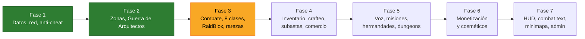

# Roadmap

## Fases

| Fase | Sistemas | Estado |
| --- | --- | --- |
| 1 | DataManager (ProfileStore), NetworkBridge, AntiCheat | ✅ |
| 2 | ZoneManager, pantalla de carga, Guerra de Arquitectos | ✅ |
| 3 | CombatManager (FSM, tab-targeting, parry), módulo de 8 clases, RaidBloxManager, rarezas | ⏳ |
| 4 | Inventario drag & drop, CraftingManager, AuctionManager, comercio 1v1 | — |
| 5 | VoiceChannelManager, misiones, hermandades, dungeons instanciadas | — |
| 6 | Gamepasses, DevProducts, pase de batalla, transmog, mascotas | — |
| 7 | HUD, target frame, combat text, minimapa, panel de administración | — |

El detalle de cada prompt de diseño está en el documento de catálogo del proyecto.

## Decisiones tomadas

| Decisión | Motivo |
| --- | --- |
| ProfileStore en lugar de ProfileService | Sucesor del mismo autor; session locking y mensajes entre servidores |
| Rareza dentro de cada ítem | Es una propiedad del ítem, no del jugador |
| `MonedasRobux` → `MonedasPremium` | Solo la toca la monetización; nombre neutro |
| Ranuras de inventario con clave de texto | JSON corta los arrays con huecos |
| Expulsar si el perfil no carga en 60 s | Jugar con un perfil vacío pisaría los datos reales |
| Anti-cheat basado en lo que ve el servidor | Velocidad y FloorMaterial los reporta el cliente |
| Sin chequeo de atravesar paredes | Da falsos positivos; las acciones valiosas ya validan distancia |
| Nivel mínimo validado al llegar al place | El cliente puede iniciar teleports por su cuenta |
| Almacén por equipo en la Guerra | Ningún recurso es inútil; nadie se traba con la carga llena |
| Partida cancelada si un equipo queda vacío | Evita ganar solo con una cuenta alternativa |

## Pendientes conocidos

- **Fase 3/4:** registrar los remotes nuevos en `NetworkBridge` (`DEFINICIONES`). Monturas con
  `AntiCheat.SetVelocidadPermitida` y el atributo `Montado`.
- **Fase 6:** en `ProcessReceipt`, devolver `PurchaseGranted` solo si `DataManager.SaveNowAsync` confirma el guardado
  después de `MarcarRecibo`. Si no, `NotProcessedYet`. El re-roll pagado tiene que mostrar las probabilidades (política
  de Roblox sobre ítems aleatorios pagos).
- **Fase 7:** `GuerraUI` y `Avisos` son interfaces mínimas de prueba; se reemplazan con el HUD definitivo.
- **Fase 7.4:** los webhooks de Discord necesitan un proxy intermedio (Discord bloquea las peticiones de Roblox).
- Configurar los PlaceId reales en `ZoneConfig` cuando se creen los places.
- El texto de diseño del Prompt 7.4 (panel de administración) llegó incompleto.
