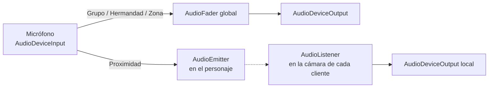

# Chat de voz

Usa la API de audio de Roblox (`AudioDeviceInput`, `AudioEmitter`,
`AudioListener`, `Wire`). La voz por defecto está apagada
(`VoiceChatService.EnableDefaultVoice = false`, `UseAudioApi = Enabled`, ya
puesto en `default.project.json`) y el juego arma su propio sistema.

> Para que ande: en **Configuración del juego → Comunicación**, activar el
> chat de voz. Solo lo usan cuentas **13+ verificadas** en los países donde
> Roblox lo permite. En Studio solo, normalmente no hay voz: se prueba publicado.

## Canales

Cada jugador habla por **un** canal (botón **🎙 Voz**). Se guarda en sus ajustes.

| Canal | Cómo suena | Quién lo oye |
| --- | --- | --- |
| Proximidad | 3D, se apaga a los 80 studs | cualquiera que esté cerca |
| Grupo | sin distancia | los de su grupo |
| Hermandad | sin distancia | los de su hermandad **en este servidor** |
| Zona | sin distancia | todos los jugadores del servidor (cada zona es un servidor) |

Si te quedás sin grupo o sin hermandad, el canal vuelve solo a Proximidad.

El panel también tiene: apagar tu micrófono y **silenciar** a otros (solo para
vos). Sobre la cabeza de quien habla aparece un 🔊.

## Cómo funciona

- El **servidor** decide quién te oye con la lista de acceso del micrófono
  (`AccessType` + `SetUserIdAccessList`): el audio solo le llega a esos
  usuarios. Se recalcula cuando cambian grupos, hermandades o jugadores.
- El **cliente** arma su escucha, corta su propio eco, baja a 0 a los
  silenciados y mide con un `AudioAnalyzer` quién está hablando.
- La voz es por servidor: la de hermandad no llega a miembros que estén en
  otro servidor.
