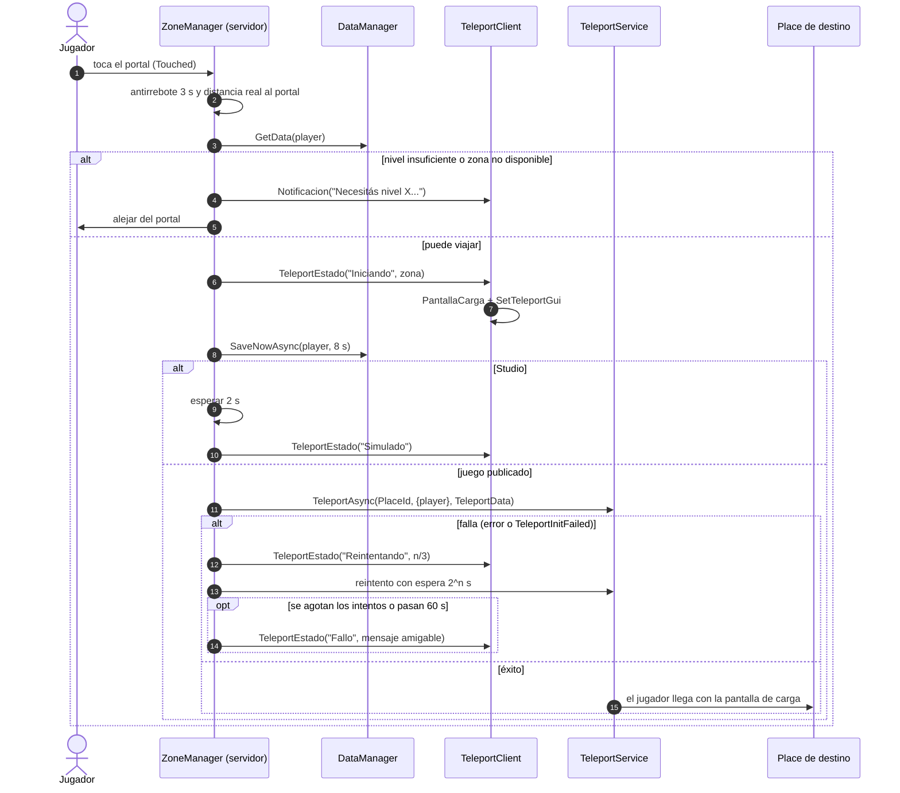
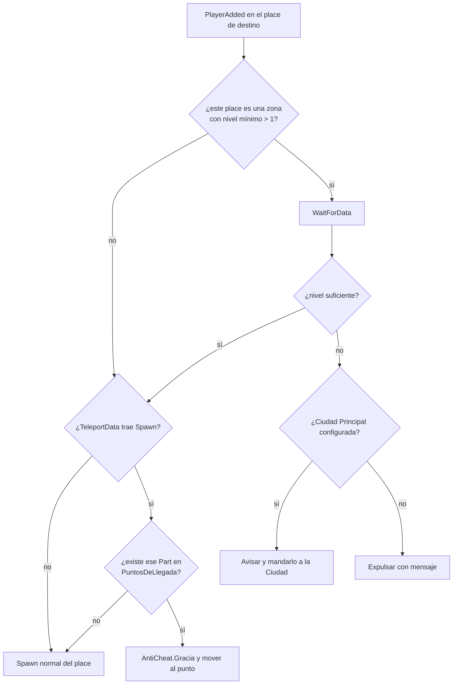

# Zonas y teletransporte

Cada zona o reino es un **Place** distinto dentro de la misma experiencia. Se configuran en
`ReplicatedStorage/Configs/ZoneConfig.luau`:

| Zona | Id | Nivel mínimo |
| --- | --- | --- |
| Ciudad Principal | `CiudadPrincipal` | 1 |
| Bosque Susurrante | `Bosque` | 1 |
| Reino de Fuego | `ReinoFuego` | 20 |
| Guerra de Arquitectos | `GuerraArquitectos` | 5 |

`PlaceId = 0` significa que el place todavía no se creó: el portal avisa que la zona no está disponible (salvo en Studio,
donde se simula).

## Portales

Un portal es cualquier `Part` con el tag `Portal` (CollectionService) y el atributo `Destino` con el id de la zona.
Opcionalmente, el atributo `Spawn` indica un punto de llegada: un `Part` con ese nombre dentro de la carpeta
`PuntosDeLlegada` del place de destino.

En Studio, si el mapa no tiene portales, se crean dos de prueba (Bosque, nivel 1, y Reino de Fuego, nivel 20).

## Flujo de un viaje

## Llegada a un place

**¿Por qué validar el nivel al llegar?** Un cliente puede iniciar un teleport por su cuenta a cualquier place de la
misma experiencia. Por eso el place de destino tiene la última palabra. El chequeo en el portal solo da un mensaje más
amable.

El `TeleportData` también lo puede modificar el cliente, así que solo se usa para elegir entre puntos de llegada que
ya existen en el place.

## Pantalla de carga

- **Al salir:** `TeleportClient` crea la pantalla con el nombre, el texto y el color de la zona (`PantallaCarga`) y
  la registra con `TeleportService:SetTeleportGui`.
- **Al llegar:** `ReplicatedFirst/LlegadaTeleport` toma esa misma pantalla con `GetArrivingTeleportGui`, quita la
  pantalla de carga por defecto de Roblox y la desvanece cuando el juego terminó de cargar.

## Poner las zonas en producción

1. En Studio: *View > Asset Manager > Places* → *Add Place* por cada zona.
2. Copiá cada PlaceId a `ZoneConfig.Zonas`.
3. Cada place necesita el mismo código (sincronizá el mismo proyecto Rojo en todos) y su propio mapa.
4. El teleport real solo funciona desde Roblox (no desde Studio).
